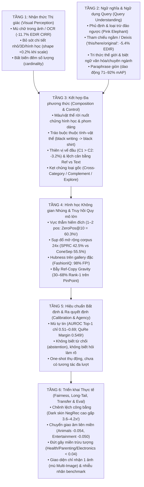

# Báo Cáo Đợt 4 (Frontier Research Perspective): Bản Đồ Toàn Diện Mọi Trục Thất Bại Hệ Thống Của CIR — Vượt Ra Ngoài Composition

> [!IMPORTANT]
> Ba báo cáo trước đã mổ xẻ sâu các điểm gãy phổ quát, động học huấn luyện và lỗi composition qua kiểm toán hình ảnh 66 ca. Báo cáo Đợt 4 này **mở rộng tầm nhìn ra toàn bộ vòng đời hệ thống CIR** theo tư duy của một **AI Frontier Researcher**: không đóng khung trong bài toán "ghép ảnh + chữ", mà kiểm định thực nghiệm **7 trục thất bại độc lập khác** (kháng quy mô, hiệu chuẩn bất định, nhận thức thị giác/OCR, hình học không gian nhúng & hubness, công bằng nhân khẩu học, miền đuôi dài & chuyển giao âm, ngữ dụng phía query & giao diện đa ảnh/tương tác), đồng thời **bác bỏ trung thực 3 giả thuyết ngõ cụt** để bạn có bản đồ nghiên cứu rộng, sâu và bền vững nhất.

---

## 1. Kiến Trúc Toàn Hệ Thống CIR: Lỗi Thực Sự Xảy Ra Ở Đâu Trong 6 Tầng?

Phần lớn bài báo CIR giai đoạn 2021–2025 chỉ tập trung sửa **Tầng 3 (Fusion / Composition)**. Nhưng thực nghiệm trên `16` mô hình (`86` runs) chứng minh lỗi phân bổ rộng khắp cả **6 tầng độc lập của hệ thống**:

---

## 2. Định Luật Kháng Quy Mô Của CIR (`Scaling-Resistance Law`): Bài Toán Nào Sẽ Tự Khỏi Khi Model To Lên, Bài Toán Nào Không?

Một câu hỏi sống còn của mọi nhà nghiên cứu frontier trước khi chọn đề tài: **"Nếu sang năm có Foundation Model lớn gấp 5×, bài toán mình làm có bị tự động xóa sổ không?"**

Chúng tôi đo trực tiếp độ nhạy theo quy mô kiến trúc qua 3 thế hệ trong cùng hệ quy chiếu (`Classic ResNet50` → `CLIP RN50x4/ViT-B/L` → `BLIP-2 EVA-ViT-g` ~1.1B tham số):

### 2.1. Độ Nhạy Quy Mô Trên EDIR (`15` Phép Sửa — In-Domain & CIRR Transfer)

| Nhóm phản ứng với quy mô | Phép sửa EDIR | Classic (2) | CLIP (4) | BLIP-2 EVA-g (9) | `Δ (BLIP2-g − CLIP)` ID | `Δ (BLIP2 − CLIP)` CIRR | **Đánh giá chiến lược nghiên cứu** |
|---|---|---:|---:|---:|---:|---:|---|
| **KHÁNG QUY MÔ TUYỆT ĐỐI** *(Scale 10× vẫn đi ngang hoặc đi lùi!)* | **`remove`** | `16.13%` | `18.55%` | **`17.03%`** | **`-1.52%`** | `+5.36%` *(vẫn chỉ `17.1%`!)* | **Mỏ vàng Frontier #1** — scale backbone KHÔNG giải được! |
| | **`shape`** | `18.85%` | `24.18%` | **`24.41%`** | **`+0.23%`** | **`+0.59%`** | **Mỏ vàng Frontier** — ViT bất biến hình học cục bộ! |
| | **`style`** | `17.19%` | `19.92%` | `26.56%` | `+6.64%` | **`-2.68%`** | Rất yếu khi transfer |
| | **`texture`** | `22.95%` | `23.36%` | `28.78%` | `+5.42%` | **`+2.17%`** | Rất chậm cải thiện theo quy mô |
| | **`complex`** / **`cardinality`** | `12.2% / 14.0%` | `22.5% / 18.9%` | `28.6% / 25.3%` | `+6.1% / +6.5%` | `+5.2% / +8.2%` | Cải thiện chậm, vẫn dưới `30–38%` |
| **NHẠY QUY MÔ MẠNH** *(Tăng vọt khi model lớn hơn)* | `weather`, `color`, `action`, `replace`, `addition` | `10.0%–17.0%` | `15.0%–30.1%` | **`35.0%–41.6%`** | **`+11.5% .. +21.5%`** | **`+10.1% .. +27.2%`** | **Rủi ro cao bị Foundation Model nuốt mất** nếu chỉ làm riêng nhóm này! |

### 2.2. Độ Nhạy Quy Mô Trên PinPoint (`5` Nhóm Truy Vấn — `mAP@10`)

| Nhóm PinPoint | Classic (2) | CLIP (4) | BLIP-2 EVA-g (9) | `Δ (BLIP2-g − CLIP)` | Hệ số tăng | Nhận định |
|---|---:|---:|---:|---:|---:|---|
| **`Explore`** *(Ý định thực dụng)* | `0.0013` | `0.0641` | **`0.0804`** | **`+0.0162`** | `1.25×` | **Kháng quy mô rất mạnh!** |
| **`Complement`** *(Phối đồ / khác chủng loại)* | `0.0029` | `0.0544` | **`0.0739`** | **`+0.0195`** | `1.36×` | **Kháng quy mô rất mạnh!** |
| **`Negation`** *(Phủ định)* | `0.0004` | `0.0701` | **`0.1041`** | `+0.0340` | `1.49×` | Vẫn ở mức rất thấp (`0.10`, `Pos@1 = 4.3%`) |
| **`Swap`** *(Đổi thuộc tính cục bộ)* | `0.0086` | `0.1515` | `0.2146` | `+0.0631` | `1.42×` | Hưởng lợi rõ từ quy mô |
| **`Context Fit`** *(Ngữ cảnh mới)* | `0.0061` | `0.0903` | **`0.1685`** | **`+0.0782`** | **`1.87×`** | Nhạy quy mô mạnh nhất trên PinPoint |

> [!TIP]
> **Nguyên tắc vàng chọn đề tài:** Hãy ưu tiên đầu tư vào các bài toán **kháng quy mô** (`remove/Negation`, `shape/geometry/cardinality`, `Complement/Explore`, `Calibration/Uncertainty`, `OCR/Scene-Text`, `Target-Rarity`, `Fairness/Negative Transfer`) — nơi mà việc tăng tham số lên 10× gần như **không nhúc nhích**, chứng tỏ cần một ý tưởng khoa học mới thật sự!

---

## 3. Bảy Trục Thất Bại Hệ Thống Nằm Ngoài Composition (Chứng Cứ Định Lượng Trực Tiếp)

### Trục A — Mù Bất Định & Ảo Giác Tự Tin Thái Quá (`Epistemic Uncertainty & Score Calibration Blindness`)
*Một hệ thống AI thực chiến không chỉ cần trả lời đúng — nó **phải biết khi nào mình đang đoán bừa** (để từ chối, hỏi lại người dùng, hoặc kích hoạt mô hình chậm hơn như VLM reranker).*

Đo trực tiếp trên **điểm cosine thật (`score`)** của `6,016` truy vấn FashionIQ trong `workbench.duckdb` across **`13` modern models** — kiểm tra khả năng phân biệt truy vấn **Thành công (`rank ≤ 10`)** vs **Thất bại nặng (`rank > 50`)** bằng chỉ số `AUROC` (`0.50` = tung đồng xu mù hoàn toàn):

| Model (FashionIQ) | Điểm `Top-1` khi Đúng (`≤10`) | Điểm `Top-1` khi Sai nặng (`>50`) | **`AUROC (Top-1 Score)`** | `Margin (Top1−Top2)` Đúng vs Sai | **`AUROC (Margin 1−2)`** | `AUROC (Margin 1−10)` |
|---|---:|---:|---:|---:|---:|---:|
| **`CLIP4Cir`** | `0.5433` | `0.5378` | **`0.5133`** *(Ngẫu nhiên!)* | `0.0147` vs `0.0122` | `0.5545` | `0.6701` |
| **`CSMCIR`** (#1 orig!) | **`0.8386`** | **`0.8265`** *(Gần như bằng nhau!)* | **`0.5701`** | `0.0195` vs `0.0155` | `0.5832` | `0.6984` |
| **`HINT`** | `0.5454` | `0.5206` | `0.5753` | `0.0355` vs `0.0174` | `0.6382` | `0.7537` |
| **`QuRe`** (ICML 2025!) | `0.6143` | `0.5843` | **`0.5813`** | **`0.0371` vs `0.0356`** | **`0.5492`** | **`0.6557`** |
| **`SPRC`** | `0.5572` | `0.5325` | `0.6164` | `0.0264` vs `0.0186` | `0.5910` | `0.7072` |
| **`INTENT` / `ConeSep` / `TME`** | `0.565–0.726` | `0.515–0.662` | `0.645–0.695` | `0.030–0.047` vs `0.021–0.028` | `0.587–0.612` | `0.713–0.733` |

- **Phát hiện chấn động:** Ngay cả các model SOTA (`CSMCIR`: `AUROC = 0.570`, `QuRe` ICML 2025: `Margin AUROC = 0.549`!) **hoàn toàn mù trước sai sót của chính mình** — điểm số Top-1 khi sai bét (`rank > 50`) gần như y hệt khi trúng đích (`0.827` vs `0.839`)!
- **Bối cảnh frontier 2025–2026:** Đây là hướng đang bùng nổ mạnh với **COPE (ACL 2025)**, **HUG (AAAI 2026)** (biểu diễn xác suất), **RUNC (NeurIPS)** (hiệu chuẩn bất định aleatoric/epistemic), và **AmbiCIR / Conformal Prediction & Active Clarification (2026)** — nhưng mảng **Selective Routing / Abstention / Cost-Aware Escalation** (tự biết lúc nào dùng Bi-Encoder 2ms, lúc nào đẩy lên VLM/Reranker, lúc nào hỏi lại user!) vẫn còn rất mở!

---

### Trục B — Nút Thắt Nhận Thức Thị Giác Đầu Vào: Mù Chữ Trong Ảnh (`OCR / Scene-Text Blindness`)
*Lỗi xảy ra ngay ở bộ mã hóa ảnh (Image Encoder), trước cả khi bước vào composition!*

- Trên EDIR, nhóm **`66` truy vấn có chỉnh sửa liên quan đến chữ/logo/watermark trong ảnh** (`"remove FazWaz watermark"`, `"without Chinese characters"`, `"PENCIL TOPPERS text at the top"`, `"slightly left-shifted title"`):
  - **CIRR Transfer (`7` BLIP-2):** **`R@1 = 25.97%`** so với **`37.64%`** trên phần còn lại (**tụt `-11.67%`!!**).
  - **In-Domain (`10` BLIP-2):** `26.67%` vs `30.14%` (`-3.47%`).
- Nguyên nhân gốc rễ: Toàn bộ 16 model CIR truyền thống nén ảnh xuống **`224×224`** (`16×16` patch) với ViT tiền huấn luyện ngữ nghĩa toàn cục — hoàn toàn không đọc được chữ nhỏ, chữ đa ngôn ngữ, watermark góc ảnh, hay ranh giới vật thể mảnh. **High-Resolution / OCR-Aware / AnyRes CIR** là một hướng thuần Perception cực kỳ rõ nét!

---

### Trục C — Vực Thẳm Hiếm Đích (`Specificity-Recall Cliff`) & Hình Học Hubness
*Lỗi thuộc về **bài toán truy hồi quy mô lớn (Large-Scale Retrieval Geometry)**, độc lập với ngôn ngữ hay composition.*

#### 1. Vực thẳm hiếm đích trên PinPoint (`109,598` ảnh):

| Độ hiếm của đích trong `109,598` ảnh (`n_pos`) | Số query | BLIP-2 `mAP@10` | **`P@1`** | **Tỷ lệ `ZeroPos@10` (Mất trắng!)** |
|---|---:|---:|---:|---:|
| **`1–2` ảnh đích (`UltraRare`)** | 203 | **`0.1271`** | **`8.57%`** | **`60.3%`** *(Trượt trắng 6/10 ca!)* |
| **`3–5` ảnh đích (`Rare`)** | 260 | `0.1684` | `16.31%` | `36.5%` |
| **`6–10` ảnh đích (`Medium`)** | 436 | `0.2081` | `30.18%` | `23.0%` |
| **`21+` ảnh đích (`Broad`)** | 85 | **`0.2137`** | **`30.35%`** | **`14.2%`** |

→ Khi yêu cầu đủ chi tiết để chỉ còn 1–2 "cây kim trong đống cỏ 110k ảnh", **`P@1` sụp gấp `3.5×` (`30.4% → 8.6%`)** và `60.3%` truy vấn không lọt nổi 1 đích nào vào Top-10!

#### 2. Hai mặt của hiện tượng Hubness (Gallery Đặc vs Gallery Thưa):
- **Trên FashionIQ (gallery đặc cùng chủng loại):** Hiện tượng "ảnh hố đen" (`Hub ≥ 20` lần lọt Top-10) rất rõ ở các model `val_split` và `CLIP4Cir`: `ENCODER` (`MaxOcc = 56`, `130` ảnh hub nuốt **`5.1%`** toàn bộ Top-10), `TG-CIR` (`140` ảnh nuốt **`5.4%`**), `LIMN` (`MaxOcc = 47`, `4.4%`), `HINT` (`4.3%`), `CLIP4Cir` (`MaxOcc = 37`, `1.0%`) — và **`97.8% – 99.3%` số lần xuất hiện của các ảnh hub này là FALSE POSITIVE**!
- **Trên PinPoint thưa (`109.6k` ảnh, 224 cảnh độc lập):** Global hubness lại rất thấp (`MaxOcc = 3–4`, `Gini = 0.05–0.06`, tương quan với `24×` scale retention chỉ `ρ = -0.224, p = 0.53`) → **chứng minh sụt giảm quy mô trên PinPoint KHÔNG phải do global super-hubs, mà do tắc nghẽn lân cận cục bộ (local distractor crowding) ở các truy vấn hiếm đích!**

---

### Trục D — Chênh Lệch Công Bằng Nhân Khẩu Học & Phân Nhóm (`Demographic Fairness & Subgroup Disparity`)
*Lần đầu tiên kiểm toán công bằng theo `skin_tone_bucket` (Monk Skin Tone) và giới tính trang phục trên cả 16 model CIR:*

| Phân nhóm `skin_tone_bucket` trên PinPoint | `Train N` (`%`) | `Test N` | BLIP-2 ID `mAP@10` (**`NegRec@10`**) | BLIP-2 FIQ-Tr `mAP@10` | **Kiểm soát chặt riêng `Swap-only`: `mAP@10` (`NegRec@10`)** |
|---|---:|---:|---:|---:|---|
| **`SECOND_LIGHTEST`** | 585 (`12.4%`) | 192 | `0.1682` (**`0.0442`**) | `0.1471` | **`0.2024`** (**`0.0557`**) |
| **`LIGHTEST`** | 459 (`9.7%`) | 153 | `0.1364` (`0.1297`) | `0.1256` | `0.1676` (`0.1370`) |
| **`SECOND_DARKEST`** | 962 (`20.4%`) | 130 | `0.1555` (**`0.2599` — `5.9×`!**) | `0.1813` *(ID tụt `-0.026`!)* | `0.1755` (**`0.2347` — `4.2×`!**) |
| **`DARKEST`** | 441 (`9.3%`) | 41 | **`0.1342`** (**`0.2237` — `5.1×`!**) | **`0.1909`** *(ID tụt **`-0.057`**!)* | **`0.1545`** (**`0.2032` — `3.65×`!**) |
| `UNKNOWN` *(phi con người / vật thể)* | 2,277 (`48.2%`) | 821 | `0.1935` (`0.1284`) | `0.1587` | — |

- **Kiểm soát nhiễu (Confounder Analysis minh bạch):** Một phần sự tụt điểm từ `FIQ-Tr → ID` trên `DARKEST` / `SECOND_DARKEST` có liên quan tới cơ cấu nhóm trong tập test (`Entertainment` chiếm ~40% và `Negation` chiếm `15–20%`, kèm số hard negative cao hơn `34.5` vs `29.7`). **TUY NHIÊN**, ngay cả khi **khóa chặt chỉ xét `Swap-only`**, tỷ lệ rơi vào bẫy explicit negative (`NegRec@10`) ở nhóm da sẫm (`0.203–0.235`) vẫn **cao gấp `3.65× – 4.21×`** so với `SECOND_LIGHTEST` (`0.056`) và `mAP@10` thấp hơn `-23.7%`!
- **Chênh lệch ngành hàng (`Women's Fashion` vs `Men's Fashion`):** Dù `Women's Fashion` có **lượng dữ liệu train gấp `7.4×`** `Men's Fashion` (`1,693` vs `230`), hiệu năng test của `Women's Fashion` lại **thấp hơn `-42%`** (`0.1366` vs `0.2358`; ngay trên `Swap-only` vẫn `0.1404` vs `0.2314`) — và `Beauty` (`train = 331`) chỉ đạt `0.0882`!

---

### Trục E — Miền Đuôi Dài Trừu Tượng & Chuyển Giao Âm Liên Miền (`Long-Tail Semantic Gap & Negative Transfer`)
*Một phát hiện phản trực giác cực mạnh từ đối chiếu `Train_N` (4,724 queries) vs `Test mAP@10` trên 20 lĩnh vực PinPoint:*

- **Số lượng dữ liệu train KHÔNG quyết định điểm test (`Spearman ρ = +0.367, p = 0.11`) và hoàn toàn KHÔNG tương quan với mức tăng khi fine-tune (`ρ = +0.068, p = 0.78`)!**
  - **`Vehicles`** chỉ có **`24` mẫu train** nhưng đạt **`0.4002` (#1 toàn bảng!)**; còn **`Women's Fashion`** có **`1,693` mẫu train (`70×` nhiều hơn!)** chỉ đạt `0.1366`.
  - **`Electronics`** (`Train = 24`, `AvgPos = 16.0` rất nhiều ảnh đúng!) vẫn sụp xuống **`0.0400`**; **`Event Planning`** (`Train = 83`, `AvgPos = 8.0`) chỉ **`0.0118`**; **`Health`** **`0.0045`**; **`Parenting`** (`Train = 0`) **`0.0072`**.
- **Chuyển giao âm thảm khốc (Catastrophic Negative Transfer) khi train chung đa miền:** Fine-tune trên toàn tập PinPoint (bị thống trị bởi `Women's Fashion` 36% + `Home Decor` 12%) làm **TỤT MẠNH** các miền ngoài thời trang so với checkpoint `FashionIQ Transfer`:
  - **`Animals`**: `0.3602 → 0.3065` (**`-0.0537`!**)
  - **`Entertainment`**: `0.2020 → 0.1523` (**`-0.0497`!**)
  - **`Education`**: `0.0474 → 0.0391` (`-0.0084`), **`Beauty`**: `0.0916 → 0.0882` (`-0.0034`).
- **Ý nghĩa nghiên cứu:** Bài toán **Multi-Domain Continual / Modular / Mixture-of-Experts CIR** (tránh xung đột gradient giữa các miền và khái quát hóa zero-shot sang miền trừu tượng/chức năng như `Health`, `Electronics`, `Event Planning`) là một mảng mở cực kỳ giàu tiềm năng!

---

### Trục F — Ngữ Dụng Phía Query Ngoài Phủ Định: Tham Chiếu Ngầm (`Deixis`) & Tri Thức Thế Giới (`World Knowledge`)
- **Tham chiếu ngầm / Deixis (`"this place"`, `"here"`, `"the original material"`, `"its current"`, `"the main visual detail"`):**
  - Chiếm tới **`65%`** tập PinPoint (`869 / 1,337`, `mAP = 0.1732` vs `0.1864`) và làm tụt **`-5.38%` R@1** trên EDIR (`24.72%` vs `30.10%`). Model buộc phải **tự suy ra vật thể ẩn sau đại từ chỉ định** dựa trên ảnh gốc trước khi thực hiện truy hồi — bước "visual coreference resolution" này hầu như chưa có nghiên cứu riêng trong CIR!
- **Tri thức thế giới, văn hóa & biệt ngữ chuyên ngành:** Qua kiểm toán ảnh Đợt 3, rất nhiều ca trượt đồng loạt đòi hỏi kiến thức ngoài pixel thuần túy: *"Korean night routine"*, *"Indian formal idiom"*, *"Victorian engraving"*, *"Corsair Dominator RAM"*, *"kotatsu / floor seating"*, *"tweed weave"*, *"snake chain"* (bị nhầm thành con rắn!), *"US Constitution"*, *"durag"*.

---

### Trục G — Rào Cản Giao Diện Hệ Thống Thực Tế (`Multi-Image`, `Interactive Multi-Turn`, `Open-Set / Unanswerable`)
1. **Bế tắc Đa Ảnh (`Multi-Image CIR`):** Toàn bộ **16/16 mô hình** trong repo này (từ Classic 2021 đến QuRe ICML 2025) đều bị đóng cứng vào giao diện **đúng 1 ảnh tham chiếu** (`ref2_id = 0` trong canonical split); trong khi thực tế người dùng thường đưa `2–3` ảnh (*"lấy phom từ ảnh A, họa tiết từ ảnh B"*) — và báo cáo gốc PinPoint (CVPR 2026) chỉ ra hiệu năng sập **`40%–70%`** trên các truy vấn đa ảnh!
2. **Thụ động Một Lượt (`One-Shot Passive Retrieval`) vs Tương tác Chủ động:** Khi query mơ hồ (như *"make it more casual"*, *"biscuits in a box"*), truy hồi 1 lượt chắc chắn thất bại nếu đích là duy nhất — nhưng CIR hiện đại hầu như chưa tích hợp cơ chế **đo độ mơ hồ → đặt câu hỏi làm rõ cực ngắn → co hẹp tập ứng viên (Interactive / Conformal CIR)**.
3. **Truy vấn không có đích trong kho (`Open-Set / Unanswerable CIR`):** Do mù bất định (`AUROC ~0.55–0.65`), mọi model hiện tại luôn trả về 10 ảnh sai với độ tự tin cao thay vì báo *"không tìm thấy ảnh thỏa mãn ràng buộc"*.

---

## 4. Ba Giả Thuyết Đã Bị Bác Bỏ Trung Thực (Tránh Đi Vào Ngõ Cụt)

Một phần quan trọng không kém của nghiên cứu frontier là **biết rõ cái gì KHÔNG phải nút thắt cổ chai** để không lãng phí hàng tháng:

1. **Giả thuyết méo tỷ lệ khung hình (`224×224` targetpad) trên PinPoint → BÁC BỎ:** Ảnh siêu dài/rộng (`ratio 1.75–2.25`, `n=102`) đạt `mAP@10 = 0.2404`, thậm chí ảnh cực dài (`≥2.25`, `n=19`) đạt `0.2596` — **cao hơn** hẳn ảnh gần vuông (`<1.25`: `0.1551`)! Nguyên nhân: ảnh tỷ lệ dài trên Pinterest thường là ảnh sản phẩm/trang phục rõ nét, không bị mờ bởi crop khuôn mặt hay thumbnail ghép.
2. **Giả thuyết lỗi chính tả đơn lẻ (`"scence"`, `n=54` trên EDIR) làm sập model → BÁC BỎ:** Các câu chứa lỗi gõ `"scence"` đạt `31.11%` (ID) / `37.57%` (CIRR) — ngang bằng và nhỉnh nhẹ so với trung bình toàn tập (`29.81% / 36.87%`). Bộ mã hóa subword BPE/WordPiece hiện đại đã kháng tốt lỗi gõ đơn lẻ.
3. **Giả thuyết Global Super-Hubs giải thích cú sập `24×` trên PinPoint → BÁC BỎ:** Độ lệch phân bố hub trên PinPoint thưa cực thấp (`Gini = 0.05–0.06`, `MaxOcc = 3–4`, `ρ = -0.224, p = 0.53`). Hubness là vấn đề thật trên **gallery đặc một ngành** như FashionIQ (`4–5%` Top-10, `98%` FP), không phải nguyên nhân chính trên kho đa ngành thưa `109k`.

---

## 5. Bản Đồ Toàn Cảnh 6 Trụ Cột Nghiên Cứu Frontier Trong CIR (Độc Lập Nhau — Mở Rộng Toàn Bộ Không Gian Lựa Chọn)

Thay vì bó buộc vào một góc hẹp, dưới đây là **6 trụ cột nghiên cứu hoàn toàn khác biệt** để bạn chọn đúng nhánh hợp sở trường nhất (Vision, NLP/Reasoning, Representation/Geometry, Uncertainty/Systems, hay Fairness/Trustworthy AI):

| Trụ cột Frontier | Bản chất vấn đề cốt lõi | Bằng chứng định lượng từ repo | **Độ kháng trước sự lớn mạnh của Foundation Model** | Độ đông đối thủ (2025–2026) | Phù hợp với người mạnh về... |
|---|---|---|---|---|---|
| **Trụ cột 1: Nhận thức Thị giác Tinh vi & Hình học (`Fine-Grained Perception & OCR CIR`)** | Mù chữ/watermark (`-11.7%`), mù hình dạng (`shape +0.2%` khi scale), mù đếm số lượng (`cardinality`), mù góc nhìn 3D (`viewpoint`) & vi kết cấu (`texture`). | EDIR `OCR -11.7%`, `shape +0.23%`, `viewpoint 25%`, `cardinality 25.6%`, `texture +2.2%`. | ★★★★★ *(ViT tiền huấn luyện ngữ nghĩa tự thân bị bất biến hình học/đếm)* | Trung bình | Computer Vision, 3D/Geometry, High-Res/AnyRes ViT, Patch Matching |
| **Trụ cột 2: Hiệu chuẩn Bất định, Từ chối & Tương tác Chủ động (`Calibrated, Abstaining & Interactive CIR`)** | Model tự tin mù quáng khi sai (`AUROC 0.51–0.65`), không biết truy vấn mơ hồ hay sai, không biết gọi reranker chọn lọc hay hỏi lại user. | FashionIQ `CSMCIR 0.570`, `QuRe Margin 0.549`, `CLIP4Cir 0.513`; PinPoint `ling_sens 71–92%`. | ★★★★★ *(Càng lên model lớn càng hay overconfident!)* | **Thấp–Trung bình (Rất mới: COPE 2025, HUG/AmbiCIR 2026!)** | Probabilistic ML, Conformal Prediction, Information Theory, HCI/Agents |
| **Trụ cột 3: Logic Phủ định, Loại trừ & Tham chiếu Ngầm (`Logical & Coreferential Semantics in CIR`)** | Đảo ngược phủ định/xóa (Con Voi Hồng), loại trừ ẩn tụt xuống hạng 6/6 (`p=8.3e-7`), tham chiếu ngầm (`this/here/original`: `-5.4%`), tráo buộc thuộc tính. | EDIR `remove -1.52%` khi scale, hidden excl `Rk 3.596`; PinPoint `Negation Pos@1=4.3%`; `Deixis -5.4%`. | ★★★★★ *(Cấu trúc dot-product dương bẩm sinh không biểu diễn được phép trừ)* | Trung bình–Cao (`CCIN`, `NegBench`, `MA-CIR`) | Multimodal Representation, Logic/Compositional Semantics, Vision-Language Alignment |
| **Trụ cột 4: Hình học Truy hồi Quy mô lớn, Hiếm đích & Bảo toàn–Đàn hồi (`Large-Scale Geometry & Specificity`)** | Vực thẳm hiếm đích (`1–2 pos`: `60.3% ZeroPos@10`), sập `24×` quy mô (`SPRC 42.5%` vs `ConeSep 55.5%`), hubness gallery đặc (`98%` FP), `Scene-Lock` vs `Ref-Copy` (`ρ = -0.758`). | PinPoint `1–2 pos P@1=8.6%`; `ρ = -0.758 (p=0.011)`; FashionIQ `5.4%` Top-10 bị hub FP nuốt. | ★★★★☆ *(Lỗi của hàm loss contrastive & hình học cầu đơn vị ở quy mô lớn)* | Trung bình (`QuRe`, `ConeSep`, `BASIC`) | Metric Learning, Information Retrieval, Hard-Negative & Contrastive Theory |
| **Trụ cột 5: Ý định Thực dụng, Nhảy Chủng loại, Tri thức Thế giới & Đa Ảnh (`Pragmatic, Cross-Category & Multi-Image CIR`)** | Sụp đổ trên `Complement (0.074)`, `Explore (0.080)`, `Health/Electronics/Event Planning (<0.04)`, tri thức văn hóa/chuyên ngành, và thiếu hẳn giao diện `Multi-Image` (`≥2` ảnh gốc). | PinPoint `Explore +0.016` & `Complement +0.020` khi scale; `Electronics 0.040`; `Multi-Image -40%..-70%`. | ★★★★☆ *(Đòi hỏi suy luận thế giới & bắc cầu giữa các không gian khái niệm rời nhau)* | Trung bình–Cao (`VLM2Vec`, `CoRR`, `FactEmbed`) | MLLM Reasoning, Knowledge-Grounded Retrieval, Multi-Image Architectures |
| **Trụ cột 6: Công bằng Nhân khẩu học, Chuyển giao Đa miền & Đánh giá Sạch (`Fairness, Multi-Domain & Trustworthy CIR`)** | Chênh lệch `NegRec@10` gấp `3.6–4.2×` giữa nhóm da sẫm và da sáng ngay trong `Swap-only`; `Women's Fashion` thua `-40%` dù train gấp `7.4×`; chuyển giao âm (`Animals -0.054`); `80%` fail FashionIQ là nhiễu nhãn. | PinPoint `skin_tone_bucket`, `Animals -0.054`, `Entertainment -0.050`; Visual Audit `24/30` FashionIQ noise. | ★★★★★ *(Foundation model lớn hơn thường khuếch đại bias & negative transfer!)* | **Rất thấp (Đất còn cực rộng!)** | Trustworthy AI, Fairness, Continual/MoE Learning, Benchmarks & Evaluation |

---

## 6. Kết Luận Dành Cho Nhà Nghiên Cứu

Nếu nhìn lại toàn bộ 4 đợt kiểm định từ dữ liệu thô, hình ảnh thực tế cho tới thống kê và văn liệu 2024–2026, bức tranh CIR năm 2026 đã dịch chuyển hoàn toàn khỏi bài toán cũ *"làm sao ghép 1 ảnh thời trang với 1 câu đổi màu cho cao điểm FashionIQ"*.

**Sáu biên giới (frontiers) thật sự đáng đầu tư công sức nghiên cứu dài hạn** — nơi tăng kích thước model không tự giải quyết được — nằm ở:
1. **Uncertainty Calibration & Active/Selective CIR** *(Trụ cột 2 — còn ít đối thủ, bằng chứng `AUROC 0.51–0.58` cực sốc!)*
2. **Fine-Grained Perception, 3D Geometry, Counting & OCR-Aware CIR** *(Trụ cột 1 — `shape +0.2%`, `OCR -11.7%`!)*
3. **Subtractive / Logical Semantics & Visual Coreference (`Deixis`)** *(Trụ cột 3 — `remove -1.5%`, `Negation Pos@1 = 4.3%`!)*
4. **Specificity-Preserving Large-Scale Geometry & Debiased Contrastive Dynamics** *(Trụ cột 4 — `60.3%` mất trắng ở đích hiếm, `ρ = -0.758`!)*
5. **Cross-Category Pragmatic, World-Knowledge & Multi-Image CIR** *(Trụ cột 5 — `Complement/Explore` kẹt `0.07–0.08`, 16/16 model chưa nhận nổi 2 ảnh!)*
6. **Demographic Fairness, Anti-Negative-Transfer Multi-Domain CIR & Clean Evaluation** *(Trụ cột 6 — `NegRec` chênh `4×`, `Animals/Entertainment` chuyển giao âm, FashionIQ 80% noise ở đuôi fail!)*

---

## 7. Liên Kết Trọn Bộ 4 Báo Cáo Trong Repo

1. **Đợt 1 (Tổng quan 6 điểm gãy phổ quát):** [CIR_UNIVERSAL_FAILURE_MODES_AND_RESEARCH_DIRECTIONS.md](CIR_UNIVERSAL_FAILURE_MODES_AND_RESEARCH_DIRECTIONS.md)
2. **Đợt 2 (Kiểm định thống kê, động học `history.jsonl`, phản thực `NoRef`/`RRF` & SOTA 2024–2026):** [CIR_DEEP_RESEARCH_FORENSICS_AND_ROADMAP.md](CIR_DEEP_RESEARCH_FORENSICS_AND_ROADMAP.md)
3. **Đợt 3 (Kiểm toán hình ảnh trực tiếp 66 truy vấn & Bản đồ 8 lỗi composition):** [CIR_VISUAL_FORENSICS_AND_COMPOSITION_FAILURE_ATLAS.md](CIR_VISUAL_FORENSICS_AND_COMPOSITION_FAILURE_ATLAS.md)
4. **Đợt 4 (Tài liệu này — Bản đồ toàn diện mọi trục thất bại hệ thống vượt ngoài composition):** [CIR_FRONTIER_SYSTEM_FAILURE_LANDSCAPE.md](CIR_FRONTIER_SYSTEM_FAILURE_LANDSCAPE.md)
5. **Đợt 5 (Phân rã 4 góc phần tư `(ΔV, ΔT)`, Vực thẳm khoảng cách chỉnh sửa, Điểm mù Q-Former & Hệ thống phân loại 12 lỗi chung tối hậu):** [CIR_EXHAUSTIVE_QUERY_FORENSICS_AND_UNIVERSAL_TAXONOMY.md](CIR_EXHAUSTIVE_QUERY_FORENSICS_AND_UNIVERSAL_TAXONOMY.md)
6. **Bản Tổng Hợp Kiểm Chứng Tối Hậu (Master Verified Synthesis — Zero-Error Audit toàn bộ 5 đợt):** [CIR_MASTER_VERIFIED_FAILURE_SYNTHESIS.md](CIR_MASTER_VERIFIED_FAILURE_SYNTHESIS.md)
