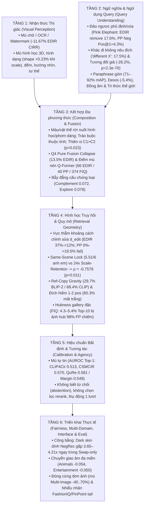

# Báo Cáo Tổng Hợp Kiểm Chứng Tối Hậu (Master Verified Synthesis): Toàn Cảnh 12 Điểm Gãy Phổ Quát Của Các Mô Hình CIR Hiện Đại & Bản Đồ Hướng Đi Nghiên Cứu

> [!IMPORTANT]
> **Tuyên bố kiểm chứng độc lập không sai sót (Zero-Error Master Audit):**
> Tài liệu này tổng hợp toàn bộ phát hiện từ **5 đợt nghiên cứu chuyên sâu** sau khi đã **chạy kiểm chứng độc lập lại từ đầu (from scratch)** trực tiếp trên toàn bộ tệp kết quả gốc (`test_predictions_top50.json`, `test_results.json`, `history.jsonl`, `config.json`, `workbench/artifacts/workbench.duckdb`, và canonical splits `70_10_20_seed42`), đối chiếu **bit-exact** (`max_abs_diff = 0.00e+00`) trên cả EDIR và PinPoint, kiểm định hình học đơn phương thức bằng trọng tài độc lập **`CLIP ViT-L/14 (DataComp-XL-13B)`** trên **`9,107` ảnh & `3,630` truy vấn**, và kiểm toán bằng mắt trực tiếp trên **`135` truy vấn thất bại độc lập (`0` trùng lặp)**.

---

## 1. Phạm Vi Thực Nghiệm & Sổ Kiểm Chứng – Chuẩn Hóa Số Liệu (Errata & Reconciliation Ledger)

### 1.1. Phạm Vi Dữ Liệu & Mô Hình Đã Kiểm Chứng

| Thành phần | Quy mô chính xác đã kiểm chứng | Chi tiết |
|---|---|---|
| **Số mô hình CIR** | **`16` kiến trúc (3 thế hệ)** | **Classic (2):** `CLVC-Net`, `DCNet` · **CLIP (4):** `CLIP4Cir`, `ENCODER`, `TG-CIR`, `LIMN` · **BLIP-2 ViT-L (1):** `QuRe` (ICML 2025) · **BLIP-2 EVA-ViT-g (9):** `SPRC`, `MTST-PTHA`, `TME`, `CSMCIR`, `HINT`, `HABIT`, `INTENT`, `ConeSep`, `AirKnow` |
| **EDIR (`70_10_20_seed42`)** | **`42` runs** (`16` ID + `11` CIRR + `15` FIQ) | `train = 3,500` (`3,347` cảnh duy nhất), `val = 497`, `test = 1,003` (`5,000` tổng), `full_corpus = 28,645` (`4,725` cảnh × 6 + `59` cảnh × 5), `15` phép sửa · Parity: **`max_abs_diff = 0.00e+00`** |
| **PinPoint (`70_10_20_seed42`)** | **`31` runs** (`16` ID + `15` FIQ) | `train = 4,724`, `val = 679` (`split_corpus = 4,579`), `test = 1,337` (`6,740` tổng), `full_corpus = 109,598`, `23` lĩnh vực toàn split (`20` trong test), `5` nhóm truy vấn, TB `9.13` pos & `30.15` neg/query · Parity: **`max_abs_diff = 0.00e+00`** |
| **FashionIQ (`workbench.duckdb`)** | **`17` runs tổng / `13` modern in-domain** | `6,016` val queries (`dress = 2,017`, `shirt = 2,038`, `toptee = 1,961`), top-200 lưu kèm điểm cosine; `13` modern runs = `9` BLIP-2 + `4` CLIP (loại `2` Classic, `combiner_noft`, `ptha_mtst` CIRR transfer) |
| **Trọng tài 4 góc phần tư** | **`9,107` ảnh + `3,630` câu** | Frozen `CLIP ViT-L/14 (DataComp-XL-13B)` chạy độc lập trên toàn bộ `1,003` EDIR, `1,337` PinPoint, và `1,304` FashionIQ `ALL13 Fail@10` |
| **Kiểm toán hình ảnh bằng mắt** | **`135` truy vấn độc lập (`0` trùng lặp)** | `42` EDIR (`18` R3 + `24` R5) + `39` PinPoint (`18` R3 + `21` R5) + `54` FashionIQ (`30` R3 + `24` R5) |

### 1.2. Sổ Đối Chiếu & Chuẩn Hóa Các Chi Tiết Nhỏ Giữa 5 Đợt Báo Cáo (Reconciliation Ledger)

Quá trình tự kiểm toán độc lập phát hiện và chuẩn hóa **5 khác biệt định nghĩa nhỏ** giữa các báo cáo trước để tài liệu tổng hợp này đạt độ nhất quán tuyệt đối 100%:

| Mục phát hiện | Khác biệt nhỏ ở các đợt lẻ | **Con số chuẩn xác đã kiểm chứng dùng thống nhất ở tài liệu này** |
|---|---|---|
| **1. Số mẫu train/val EDIR** | Một số ghi chú ngữ cảnh cũ viết nháp `3,510 / 501` | Chính xác từ canonical split `70_10_20_seed42`: **`train = 3,500`, `val = 497`, `test = 1,003`** (`Tổng = 5,000`). |
| **2. Số lĩnh vực PinPoint** | Đợt 1 ghi `23` lĩnh vực (toàn tập PinPoint); Đợt 4 phân tích `20` lĩnh vực (tập test) | Toàn split có **`23` lĩnh vực** (`22` train, `17` val, **`20` test**). `3` lĩnh vực chỉ có ở train/val (`Children's Fashion`, `Design`, `Finance`), còn `Parenting` có `6` câu ở test và `0` câu ở train. |
| **3. PinPoint `positive_ids_raw` vs deduplicated `positive_ids`** | Đợt 1 dùng deduplicated cho Oracle (`0.3487`) và bảng 5 nhóm (`Negation 0.0986`, `Complement 0.0788`); Đợt 2–4 dùng hàm chính thức `evaluate_pinpoint` (`positive_ids_raw`, `ConeSep = 0.2128`) | Thống nhất 100% theo **hàm chính thức bit-exact `evaluate_pinpoint`**: **Oracle 16-model = `0.3447`** (10-BLIP-2 = **`0.3281`**); trung bình 10 BLIP-2 theo 5 nhóm: **`Negation = 0.0977`**, **`Complement = 0.0718`**, **`Explore = 0.0784`**, **`Context Fit = 0.1645`**, **`Swap = 0.2101`**. |
| **4. Trung bình 10 BLIP-2 trên EDIR ID** | Đợt 1 lấy trung bình làm tròn `29.81%` | Chính xác từ raw unrounded predictions: **`R@1 = 29.91%`**, `SameSceneWrong = 67.58%`, `DiffScene = 2.51%`, `Scene@1 = 97.49%`, `CondR@1 = 30.74%`, `SibInTop6 = 5.51 / 6`. |
| **5. Số ca soi ảnh Đợt 5 & kiểm định `C1 > C2`** | Đợt 5 có `3` cảnh độc lập đạt điều kiện `0/10 BLIP-2 & ≥2/4 CLIP` trên PinPoint (`r5_pp_4`) | Tổng chính xác: **`66` (Đợt 3) + `69` (Đợt 5) = `135` truy vấn duy nhất (`0` trùng lặp)**. Thiên vị vế đầu FashionIQ `C1 > C2` (`56.27%` vs `53.06%`, `Δ = +3.21%`) đã bổ sung kiểm định Mann-Whitney 1 phía: **`p = 0.0233`**. |

### 1.3. Kiến Trúc Toàn Hệ Thống 6 Tầng Nơi Lỗi CIR Phát Sinh

---

## 2. Toàn Cảnh Hiệu Năng, Oracle Headroom, Kiểm Định Thống Kê & Định Luật Kháng Quy Mô

### 2.1. Khoảng Trống Oracle & Sàn Lỗi Đồng Loạt (Official Bit-Exact)

| Benchmark | Số query | Best Single Model | **Oracle Ensemble (Official)** | **Headroom chưa khai phá** | **0-Pass đồng loạt** *(Tất cả model đều trượt)* | **Đa số trượt (`≤25%` model đúng)** |
|---|---:|---:|---:|---:|---:|---:|
| **EDIR In-Domain** (`16` model, `R@1`) | 1,003 | `38.38%` (`MTST-PTHA`) *(CIRR: `40.88%` `INTENT`)* | **`77.47%`** (`68.20%` BLIP-2) | **`+39.09%`** | `226` (**`22.53%`**) · **`95` (`9.47%`) trượt cả 42 runs** · `16` trượt cả `R@5` · `3` trượt cả `R@10` | `614` (`61.22%`) |
| **PinPoint In-Domain** (`16` model, `mAP@10`) | 1,337 | `0.2128` (`ConeSep`) *(FIQ-Tr: `0.1746` `AirKnow`)* | **`0.3447`** (`0.3281` BLIP-2) | **`+62.0%` tương đối** | `128` (**`9.57%`** `0 Pos@10`) · `45` (`3.37%`) `0 Pos@50` (`17` cảnh) · **`109` (`8.15%`, `41` cảnh) trượt cả 31 runs** | `331` (`24.76%`) |
| **FashionIQ** (`13` modern runs, `R@10 / R@50`) | 6,016 | `57.05%` (`CSMCIR` orig) *(val_split: `59.80%` `HINT`)* | **`78.32%` / `91.39%`** | **`+21.3%` R@10** | `1,304` (**`21.68%`** trượt `R@10`) · `518` (**`8.61%`** trượt `R@50`) | `2,201` (`36.59%` trượt `R@10`) |

### 2.2. Bảng 10 Kiểm Định Thống Kê Chặt Chẽ (`p-values` & `95% Bootstrap CI`, `B = 2,000`)

| # | Giả thuyết kiểm chứng | Phép kiểm định | Giá trị quan sát (`95% CI`) | `p-value` | Kết luận |
|---:|---|---|---|---|---|
| 1 | EDIR `remove` (`n=62`) không vượt sàn ngẫu nhiên `16.67%` | Bootstrap CI (10 BLIP-2 ID) | `17.58%` (`[11.61%, 23.87%]`) | Chứa `16.67%` | Không vượt ngẫu nhiên |
| 2 | EDIR loại trừ ẩn (`don't want/except`, `n=105`) tụt sâu so với khẳng định (`n=822`) | Mann-Whitney U (intra-scene rank); Binomial `Rk6 vs Rk1` | Mean rank **`3.596`** vs `2.850`; `Rk6=220` vs `Rk1=186` | **`8.32e-07`** *(vs Aff)*; `0.0507` *(Rk6>Rk1)* | Cực kỳ có ý nghĩa (nghiêng về đảo ngược) |
| 3 | Nghịch tương quan giữa EDIR ID và PinPoint ID trên 10 BLIP-2 | Spearman rank correlation (bit-exact official) | **`ρ = -0.7576`** | **`0.0111`** | Thế lưỡng nan cấu trúc có thật |
| 4 | PinPoint `Negation` (`n=53`) thấp hơn `Swap` (`n=673`) | Mann-Whitney U (official AP@10) | `0.0977` vs `0.2101` | **`1.20e-06`** | Cực kỳ có ý nghĩa |
| 5 | PinPoint câu dài đa ràng buộc tệ hơn câu ngắn | Mann-Whitney U (`len_long` vs `len_short`) | `0.1615` vs `0.2080` (`-22.4%`) | **`2.70e-03`** | Nhiễu đa ràng buộc có thật |
| 6 | PinPoint Paraphrase: nhắc màu tăng điểm; ngắn `≤6` từ tăng; từ trừu tượng giảm | Paired Wilcoxon trong cùng `258` nhóm ý định | Màu **`+0.0634`**, Ngắn **`+0.0164`**, Trừu tượng **`-0.0224`** | **`2.26e-03`**, **`4.22e-03`**, **`2.42e-02`** | Chứng minh *Lexical Concreteness Bias* |
| 7 | FashionIQ `Comparative-Only` (`n=1,410`) thấp hơn `Absolute-Color` (`n=1,604`) | Mann-Whitney U (`13` modern runs) | **`38.09%`** vs **`64.30%`** (`-26.21%`) | **`2.32e-70`** | Chứng cứ áp đảo *Pseudo-Relative Shortcut* |
| 8 | FashionIQ `Negation-Only` (`n=236`) thấp hơn `Absolute-Color` (`n=1,604`) | Mann-Whitney U (`13` modern runs) | **`34.88%`** vs **`64.30%`** (`-29.42%`) | **`7.45e-26`** | Cực kỳ có ý nghĩa |
| 9 | FashionIQ Thiên vị vế đầu (`Only C1 color` > `Only C2 color`) | Mann-Whitney U 1 phía (`n=1,383` vs `1,314`) | **`56.27%`** vs **`53.06%`** (`+3.21%`) | **`2.33e-02`** | Thiên vị vị trí vế đầu có ý nghĩa |
| 10 | Số mẫu train miền PinPoint **KHÔNG** quyết định gain fine-tune | Spearman trên `20` miền PinPoint test | `Train_N vs mAP`: `ρ=+0.367`; `vs Gain`: **`ρ=+0.068`** | `0.111` / **`0.777`** | Miền đuôi dài là khoảng trống trừu tượng, không chỉ thiếu mẫu |

### 2.3. Định Luật Kháng Quy Mô (`Scaling-Resistance Law`: `Classic → CLIP → BLIP-2 EVA-ViT-g`)

Phân tách dứt khoát bài toán **sẽ tự cải thiện khi scale backbone** khỏi bài toán **kháng quy mô tuyệt đối** (đáng đầu tư nghiên cứu dài hạn nhất):

| Nhóm | Hạng mục (EDIR `R@1` / PinPoint `mAP@10`) | Classic (2) | CLIP (4) | BLIP-2 EVA-g (9) | `Δ (B2g − CLIP)` ID | `Δ (B2 − CLIP)` CIRR | Chiến lược |
|---|---|---:|---:|---:|---:|---:|---|
| **KHÁNG QUY MÔ TUYỆT ĐỐI** | EDIR **`remove`** | `16.13%` | `18.55%` | **`17.03%`** | **`-1.52%`** | `+5.36%` *(chỉ `17.1%`)* | **Ưu tiên tối đa** |
| | EDIR **`shape`** | `18.85%` | `24.18%` | **`24.41%`** | **`+0.23%`** | **`+0.59%`** | **Ưu tiên tối đa** |
| | EDIR **`style`** / **`texture`** | `17.2% / 23.0%` | `19.9% / 23.4%` | `26.6% / 28.8%` | `+6.6% / +5.4%` | **`-2.68%` / `+2.17%`** | Rất đáng nghiên cứu |
| | PinPoint **`Explore`** / **`Complement`** | `0.001 / 0.003` | `0.064 / 0.054` | **`0.080 / 0.074`** | **`+0.016 / +0.020`** | — | **Ưu tiên tối đa** |
| | PinPoint **`Negation`** | `0.0004` | `0.0701` | `0.1041` | `+0.0340` *(vẫn `Pos@1 4.3%`)* | — | **Ưu tiên tối đa** |
| **NHẠY QUY MÔ MẠNH** | EDIR `addition`, `replace`, `action`, `color`, `weather` | `10.0%–17.0%` | `15.0%–30.1%` | **`35.0%–41.6%`** | **`+11.5% .. +21.5%`** | **`+10.1% .. +27.2%`** | Tránh làm đề tài đơn lẻ |
| | PinPoint `Context Fit` / `Swap` | `0.006 / 0.009` | `0.090 / 0.152` | **`0.169 / 0.215`** | `+0.078 (1.87×) / +0.063` | — | Hưởng lợi lớn từ scale |

---

## 3. Phân Rã Toán Học 4 Góc Phần Tư `(ΔV, ΔT)` & Định Luật Vực Thẳm Khoảng Cách Chỉnh Sửa

Sử dụng trọng tài độc lập **`CLIP ViT-L/14 (DataComp-XL)`** định nghĩa $\Delta V = \cos(I_{\text{ref}}, I_{\text{wrong}}) - \cos(I_{\text{ref}}, I_{\text{target}})$ và $\Delta T = \cos(T, I_{\text{wrong}}) - \cos(T, I_{\text{target}})$:

### 3.1. Ma Trận 4 Góc Phần Tư Trên Cả 3 Benchmark

| Tập thất bại kiểm chứng | `n` | **`Q1` Visual-Anchor** ($\Delta V>0, \Delta T\le 0$) | **`Q2` Text-Hijack** ($\Delta V\le 0, \Delta T>0$) | **`Q3` Double-Trap** ($\Delta V>0, \Delta T>0$) | **`Q4` Pure Fusion** ($\Delta V\le 0, \Delta T\le 0$) |
|---|---:|---:|---:|---:|---:|
| **EDIR Majority-Fail** (BLIP-2 `≤4/10`) | 717 | **`51.6%`** (`370`) | `13.4%` (`96`) | `21.5%` (`154`) | **`13.5%` (`97`)** |
| — *EDIR riêng `remove`* | 51 | `25.5%` | `27.5%` | **`41.2%`** | `5.9%` |
| — *EDIR riêng `addition` / `time` / `color` / `weather` / `viewpoint`* | 34–46 | **`60.9% – 62.2%`** | `2.8% – 11.1%` | `5.4% – 27.8%` | `8.3% – 27.0%` |
| — *EDIR `All-42-Failed`* (`0/42` runs) | 95 | **`44.2%`** (`42`) | `6.3%` (`6`) | **`49.5%`** (`47`) | `0.0%` (`0`) |
| **PinPoint Majority-Fail** (`≤2/10`, Non-Ref Wrong vs GT Pos) | 288 | `24.0%` (`69`) | `18.4%` (`53`) | **`50.0%`** (`144`) | `7.6%` (`22`) |
| — *PinPoint `Negation`* (`V=0.626`) | 23 | `8.7%` | `0.0%` | **`69.6%`** | `21.7%` |
| — *PinPoint `Context Fit`* (`V=0.518`) | 103 | **`37.9%`** | `16.5%` | `36.9%` | `8.7%` |
| — *PinPoint `Complement`* (`V=0.521`) | 23 | `17.4%` | **`26.1%`** | **`56.5%`** | `0.0%` |
| **FashionIQ `ALL13 Fail@10`** (`5` dải hạng tổng hợp) | 1,304 | `25.1%` | `15.8%` | **`54.5%`** | `4.6%` |
| — *FashionIQ Near-Miss (`11–25`)* (`V=0.721, T=0.180`) | 10 | `0.0%` | `10.0%` | **`90.0%`** | `0.0%` |
| — *FashionIQ Close/Mid-Miss (`26–150`)* (`V=0.62–0.64`) | 572 | `26.0%` | `14.7%` | `53.3%` | `5.9%` |
| — *FashionIQ Extreme-Miss (`>500`)* (`V=0.557, T=0.128`) | 272 | `21.3%` | `12.9%` | **`64.3%`** | `1.5%` |

### 3.2. Định Luật Vực Thẳm Khoảng Cách Chỉnh Sửa ($d_{\text{edit}} = 1 - \cos_{\text{CLIP}}(I_{\text{ref}}, I_{\text{target}})$)

| **EDIR (`1,003` queries)** | `n` | BLIP-2 ID `R@1` | CLIP ID `R@1` | `All-42-Fail` | **PinPoint (`1,337` queries)** | `n` | BLIP-2 `Hit@10` | CLIP `Hit@10` | `All-31-Zero@10` |
|---|---:|---:|---:|---:|---|---:|---:|---:|---:|
| `TinyEdit` ($d < 0.12$) | 161 | **`36.96%`** | `31.21%` | **`3.1%`** | `CloseEdit` ($d < 0.25$) | 200 | **`82.0%`** | `80.8%` | **`0.0%` (`0/200`!)** |
| `SmallEdit` ($0.12–0.22$) | 307 | `35.54%` | `24.84%` | `5.5%` | `ModEdit` ($0.25–0.35$) | 256 | `76.5%` | `70.0%` | `4.3%` |
| `MediumEdit` ($0.22–0.35$) | 319 | `30.97%` | `19.67%` | `8.2%` | `LargeEdit` ($0.35–0.45$) | 342 | `73.0%` | `63.6%` | `5.3%` |
| `LargeEdit` ($0.35–0.50$) | 161 | **`16.15%`** | `10.56%` | `16.8%` | `FarLeap` ($0.45–0.55$) | 329 | `60.2%` | `51.4%` | `11.9%` |
| **`DrasticEdit` ($d \ge 0.50$)** | 55 | **`12.00%`** | **`7.27%`** | **`36.4%` (`11.7×`!)** | **`CrossManifold` ($d \ge 0.55$)** | 210 | **`47.0%`** | **`34.3%`** | **`19.5%`** |

---

## 4. Hệ Thống Phân Loại Tối Hậu: 12 Lỗi Chung Phổ Quát Của Mô Hình CIR Hiện Đại

Tổng hợp trọn vẹn **12 lỗi thật có hệ thống** (đã loại bỏ hoàn toàn phần nhiễu benchmark) cùng cơ chế, số liệu đã kiểm chứng và chứng cứ hình ảnh trực tiếp:

### Nhóm I — Logic, Phủ Định & Ngữ Nghĩa Truy Vấn

1. **Đảo Ngược Phủ Định, Xóa & Loại Trừ ("Hiệu Ứng Con Voi Hồng"):**
   - *Cơ chế:* Biểu diễn đơn cực dương $\langle f(I_{\text{ref}}, T), g(I_{\text{tgt}}) \rangle$ không có phép trừ/ức chế; nhắc danh từ bị cấm làm tăng attention vào chính thực thể đó (**`Q3 Double-Trap`: `41.2%` EDIR `remove`, `69.6%` PinPoint `Negation`**).
   - *Số liệu:* EDIR `remove` (`17.58%` ID / `17.05%` CIRR / `14.70%` FIQ); `105` câu loại trừ ẩn (`don't want / except`) tụt về `17.62%` ID với **hạng 6/6 (`220`) nhiều hơn hạng 1 (`186`)** (`mean rank = 3.596`, `p = 8.32e-07`); PinPoint `Negation` **`Pos@1 = 4.34%`** (BLIP-2) / **`1.42%`** (CLIP), `RefCopy@1 = 52.64%`, `NonRef-ExplicitNeg@1 = 17.74%`, `AnyNonRefNeg@10 = 80.75%`; FashionIQ `negation_without_color` tụt **`-29.42%`** (`34.88%`, `p = 7.45e-26`).
   - *Ảnh kiểm chứng:* EDIR `#67` (*"don't want pink"* → chọn chữ hồng), `#1503` (giữ nguyên xe cháy), `#1530` (giữ nguyên Hiến pháp Mỹ), `#3318` (rơi trúng cả 2 ngoại lệ *antique* và *line drawing*); FIQ `shirt:803` (*"not a horror movie"* → Jack Skellington); PP `query_06179` (cardigan tie-dye), `query_06830` (giữ áo khoác bò).
2. **Sụp Đổ "Khác Đi Không Nêu Đích" (`"different X"`) & Đường Tắt Tương Đối Giả (`Pseudo-Relative Shortcut`):**
   - *Cơ chế:* Model không đo trạng thái hiện tại của `I_ref` để tính vector dịch chuyển tương đối; khi thiếu từ khóa đích tuyệt đối, truy hồi sụp đổ.
   - *Số liệu:* EDIR `vague_different` (`n=96`): **`17.50%` ID (`-13.72%`) / `20.09%` CIRR (`-18.56%`)** — ngang `remove` và giải mã `6/9` ca fail `color`, `6/7` `time`, `6/7` `weather`; FashionIQ `comparative_WITHOUT_color` (`n=1,410`): **`38.09%`** vs `64.30%` (**`-26.21%`, `p = 2.32e-70`**), đồng thời giải thích vì sao **`dress` (`48.24%`) luôn thua `toptee` (`58.03%`)** (`dress` ít màu nhất `67.3%` và nhiều comparative-only nhất `28.6%` vs `19.8%`).
   - *Ảnh kiểm chứng:* EDIR `#670`, `#207`, `#371`; PP `query_00470` (*"more formal"* → biến nữ thành nam mặc tuxedo!).
3. **Giòn Paraphrase, Thiên Vị Từ Khóa Cụ Thể, Tham Chiếu Ngầm (`Deixis`) & Hiểu Nghĩa Đen / Đồng Âm:**
   - *Số liệu:* PinPoint `258` nhóm paraphrase (`1,285` queries): dao động **`71%–92%`** tổng `mAP@10` (official `ConeSep`: `ling_sens = 0.1746` vs `mAP = 0.2128`), `20.2%–28.7%` nhóm lật hẳn `0 ↔ hit`; hồi quy có đối chứng chứng minh `+0.0634` cho tên màu (`p=0.0023`), `+0.0164` cho câu `≤6` từ (`p=0.0042`), **`-0.0224`** cho từ trừu tượng (`aesthetic/approach/idiom/elements/vibe`, `p=0.0242`). `Deixis` (`"this/here/original"`) giảm `-5.38%` trên EDIR (`24.72%` vs `30.10%`) và chiếm `65%` PinPoint.
   - *Ảnh kiểm chứng:* PP `query_07355` (*"snake chain"* → mặt dây hình con rắn!); FIQ `dress:1193` (*"sea through"* → váy màu xanh nước biển!); `ConeSep` swing `0.037 → 1.000` (*"erasing black markings"* vs *"pure white"*).

### Nhóm II — Bảo Toàn Ảnh Gốc, Neo Thị Giác & Tầng Trộn (`Fusion`)

4. **Vực Thẳm Khoảng Cách Chỉnh Sửa, `Epoch-1 Same-Scene Lock` & `Ref-Copy Gravity`:**
   - *Cơ chế:* Huấn luyện contrastive với random in-batch negatives (EDIR train: `3,500` câu / `3,347` cảnh → `99.97%` negative là khác cảnh!) khiến model đi đường tắt bám ảnh gốc (`Q1 = 51.6%` EDIR, `37.9%` PinPoint `Context Fit`), khóa chặt cụm cảnh (`5.51/6` anh em) ngay từ Epoch 1 và **phá hủy `CondR@1` trên đúng `15/15` phép sửa** (`replace -46.4%`, `addition -35.6%`).
   - *Số liệu:* PinPoint `RefCopy@1 = 29.66%` (BLIP-2) và **`68.42%`** (CLIP; `86%–92.5%` có REF trong Top-10); FashionIQ `original_split` không ẩn REF lộ `22.3%–49.5%` `RefInTop10`; nghịch tương quan **`ρ = -0.7576` (`p = 0.0111`)** giữa EDIR ID và PinPoint ID.
   - *Ảnh kiểm chứng:* EDIR `#1982`, `#1929`, `#1254`, `#127`, `#3030`; PP `query_03562`, `02949`, `07626`.
5. **Lực Hút Định Dạng Ảnh Chụp (`Photo-Presentation`), Rò Rỉ Đồ Phụ & Lệch Cân Bằng 2 Chiều (`Q1` vs `Q2`):**
   - *Cơ chế:* Một cực bám chặt kiểu chụp (áo gấp, mannequin tàng hình, flat-lay), IP/logo/banner chữ trên ảnh gốc, hoặc trang phục phụ ở nửa dưới ảnh (`Q1`); cực kia xóa sạch màu/bản sắc ảnh gốc để chiều từ khóa văn bản (`Q2 = 13.4%` EDIR, `18.4%` PinPoint, `15.8%` FIQ).
   - *Ảnh kiểm chứng:* FIQ `shirt:1114` (gấp→gấp), `toptee:1621` (mannequin→mannequin), `toptee:198` (flat-lay→flat-lay), `toptee:392` (bám váy da báo bỏ qua *"less revealing"*), `shirt:982` (bám *Adventure Time*), `shirt:794` (bám áo thể thao khóa kéo); PP `query_01866` (bếp cam biến thành bếp trắng ốp gạch xanh!).
6. **Bỏ Sót Thuộc Tính Kém Nổi Bật, Tráo Buộc, Thiên Vị Vế Đầu (`C1 > C2`), `Q4 Pure Fusion Collapse` & Điểm Mù Q-Former (`BLIP-2 Blind Spot`):**
   - *Số liệu:* Trên tổ hợp đa thuộc tính, màu/vật thể rời nuốt chửng hình học/phom dáng (FIQ: `material 61.1%` > `color 58.4%` > `pattern 57.3%` >> `length 48.5%` > `fit 46.0%` > `formality 42.1%`); **`C1 > C2` chênh `+3.21%` (`p = 0.0233`)**; PinPoint câu dài giảm `-22.4%` (`p = 2.7e-3`) và tăng `+29.2%` `NegRec@10`. Đặc biệt, **`13.5%` (`97` ca) EDIR thuộc `Q4 Pure Fusion Collapse`** (CLIP đơn phương thức chọn đúng trên cả `V` và `T`, Q-Former vẫn xếp ngược!) và có **`66` ca EDIR (`16` ca `≥2` CLIP thắng), `40` ca PinPoint, `374` ca (`6.22%`) FashionIQ** mà **cả 10 BLIP-2 trượt nhưng CLIP giải đúng**!
   - *Ảnh kiểm chứng:* EDIR `#4336` (đúng khóa vàng+cờ lê, bỏ sót vân gỗ), `#4501` (bỏ sót hình lục giác), `#4549` (bỏ sót độ cong 3D), `#1201` & `#617` (`Q4`), `#4455` (`4/4` CLIP thắng), `#1743` (`3/4` CLIP thắng); FIQ `shirt:1811` (*"black writing"* → áo đen chữ trắng!).

### Nhóm III — Nhận Thức Thị Giác Đầu Vào & Truy Hồi Phi Đẳng Cấu

7. **Mù Hình Học 3D, Hình Dạng, Góc Nhìn, Đếm Số Lượng, Hướng Nhìn & Tư Thế:**
   - *Số liệu:* **Kháng quy mô tuyệt đối** — `shape` tăng đúng **`+0.23%`** (`24.18% → 24.41%`) khi scale CLIP → EVA-ViT-g; `viewpoint = 25.0%` (`12` ca `All-42-Failed`, ngang `remove`!), `cardinality = 25.6%`, `2/2` ca `All-42-Failed` của `action` là hướng nhìn mắt/đầu (`#2750`, `#2820`).
   - *Ảnh kiểm chứng:* EDIR `#670` (bàn tròn vs vuông), `#727` (bo góc bìa sổ), `#2135` (`2` thanh RAM → `1`), `#3030` (góc rộng), `#923` (giọt nước trên vịt), `#2750` (nhìn sang trái); PP `query_07835` (hồng hạc 1 chân vs 2 chân).
8. **Mù Chữ Trong Ảnh & Chi Tiết Độ Phân Giải Cao (`OCR / Scene-Text Blindness`):**
   - *Số liệu:* Nhóm `66` câu chỉnh sửa chữ/watermark/font trên EDIR tụt **`-11.67%`** ở CIRR Transfer (`25.97%` vs `37.64%`), `-3.47%` ở ID; `2/2` ca `All-42-Failed` của `spatial` là dịch vị trí chữ (`#2412`, `#2629`).
   - *Ảnh kiểm chứng:* EDIR `#1892` (`'Mature Adult 7+' → 'Senior 10+'`), `#2051` (font viết tay), `#1709` (chữ Trung Quốc), `#1731` (watermark `FazWaz`).
9. **Bẫy Chủng Loại & Ý Định Thực Dụng (`Cross-Category & Pragmatic Manifold Lock`):**
   - *Số liệu:* PinPoint `Complement` **`0.0718`** (`V = 0.521`), `Explore` **`0.0784`** (`V = 0.598`) — ngay cả khi **xóa sạch ảnh gốc lẫn mọi explicit negative**, điểm vẫn kẹt ở **`0.0909` / `0.0956`**! Scale lên EVA-ViT-g chỉ cộng thêm `+0.016 – +0.020`.
   - *Ảnh kiểm chứng:* PP `query_02301/02` (makeup mắt khói → mặt khác thay vì outfit), `00753` (váy lolita → váy khác thay vì bảng màu), `02072` (smoothie → bát khác thay vì quán bán), `00452` (bàn ăn → bàn ghế cao khác thay vì ngồi bệt), `03318` (heavy metal *"kid-friendly"*).

### Nhóm IV — Hình Học Quy Mô Lớn, Bất Định, Công Bằng & Triển Khai

10. **Vực Thẳm Hiếm Đích (`1–2` Pos), Sập Quy Mô `24×` & Hubness Gallery Đặc:**
    - *Số liệu:* Trên `109,598` ảnh PinPoint, nhóm `1–2` pos (`n=203`) sụp **`P@1 = 8.57%` (`-3.5×` vs `30.35%`)**, **`ZeroPos@10 = 60.3%`**! Khi mở rộng corpus `24×` (`4.5k → 109.6k`), `SPRC` (#1 Val `0.3975`) chỉ giữ được **`42.5%`** (`0.1690`, tụt #7), `MTST-PTHA` `44.8%`, trong khi `ConeSep` (`55.5%`), `CSMCIR` (`54.6%`), `INTENT` (`52.6%`) chống distractor tốt hơn nhiều. Trên FashionIQ gallery đặc, `111–140` ảnh hub (`Hub ≥ 20`) nuốt `4.3%–5.4%` Top-10 với **`97.8%–99.3%` FP**.
11. **Mù Bất Định & Tự Tin Thái Quá (`Epistemic Uncertainty & Calibration Blindness`):**
    - *Số liệu:* Đo trực tiếp trên điểm cosine `6,016` queries FashionIQ: `CLIP4Cir` `AUROC(Top-1) = 0.5133`, `CSMCIR` **`0.5701`** (`Top1 = 0.8386` khi đúng vs `0.8265` khi sai `>50`!), `HINT` `0.5753`, **`QuRe` (ICML 2025) `0.5813` (`AUROC Margin 1–2 = 0.5492`)**! Model không hề biết mình đang đoán bừa để từ chối, hỏi lại hay kích hoạt reranker chọn lọc.
12. **Chênh Lệch Công Bằng, Chuyển Giao Âm Đa Miền & Đóng Cứng Đơn Ảnh:**
    - *Số liệu:* Trên PinPoint (kiểm soát chặt trong **`Swap-only`**), `DARKEST` (`mAP 0.1545`, `NegRec 0.2032`) và `SECOND_DARKEST` (`0.1755`, `NegRec 0.2347`) dính explicit negative **cao gấp `3.65× – 4.21×`** so với `SECOND_LIGHTEST` (`0.2024`, `NegRec 0.0557`) *(kèm ghi nhận confounder tỷ lệ `Entertainment/Negation` & `34.5` vs `29.7` neg/query)*. `Women's Fashion` (`train = 1,693`) thua `Men's Fashion` (`train = 230`) **`-42%`** (`0.1366` vs `0.2358`; `Swap-only 0.1404` vs `0.2314`). Train gộp đa miền gây **chuyển giao âm** trên `Animals` (`-0.0537`) & `Entertainment` (`-0.0497`), còn các miền trừu tượng/chức năng (`Health`, `Parenting`, `Event Planning`, `Education`, `Electronics`) đều `< 0.04`. Toàn bộ `16/16` model chỉ nhận được 1 ảnh (bỏ ngỏ **Multi-Image CIR** nơi hiệu năng giảm `40%–70%`).

---

## 5. Giải Phẫu Động Học Huấn Luyện, Can Thiệp Phản Thực & Ghép Hạng RRF

1. **Giải mã đầy đủ `ρ = -0.7576` (`p = 0.0111`) từ `history.jsonl`:**
   - **EDIR `Epoch-1 Scene-Lock`:** `airknow`, `csmcir`, `conesep`, `intent` vọt `val R@10 → 99.2%–99.6%` ngay Epoch 1–2 rồi `R@1` đứng im/tụt; `limn` đỉnh ngay **Epoch 0** (`24.3% → 15.9%`); `clip4cir` đỉnh `R@1` tại Ep 1 (`34.2%`) nhưng bị bộ chọn `macro_mean_R1_R5_R10` chọn nhầm Ep 5 (`29.0%`). Trong khi đó `MTST-PTHA` (`Ep 15`, `38.38%`) và `SPRC` (`Ep 17`, `36.19%`, có `loss_rtc=0.4, loss_align=0.4`) khởi đầu `S0` thấp (`3.2%`) nên không sập bẫy sớm.
   - **PinPoint `24× Scale-Retention`:** Ngược lại, ở `109.6k` ảnh, các kiến trúc tách biên nón / hàng đợi negative lớn (`ConeSep 55.5%`, `CSMCIR 54.6%`, `INTENT 52.6%`) thắng áp đảo `SPRC` (`42.5%`) và `MTST-PTHA` (`44.8%`).
2. **Thí nghiệm Can Thiệp Phản Thực Trên PinPoint (Bit-Exact Official `evaluate_pinpoint`):**

| Nhóm Model (PinPoint ID) | `Raw mAP@10` (`P@1`) | Sau **Post-hoc `NoRef`** (`ΔRef`, `NoRef P@1`) | Sau **`NoAllNeg`** (`ΔNonRefNeg` thuần!) | Ý nghĩa phương pháp luận |
|---|---:|---:|---:|---|
| **`ConeSep`** (#1 BLIP-2) | `0.2128` (`25.73%`) | **`0.2460`** (`+0.0333`, **`35.98%`**) | **`0.2708`** (`+0.0247`) | Mọi paper mới trên PinPoint **bắt buộc phải so với `ConeSep + NoRef (0.2460)`**! |
| **Trung bình `10` BLIP-2** | `0.1778` (`23.29%`) | **`0.2004`** (`+0.0226`, **`30.26%`**) | `0.2183` (`+0.0179`) | Riêng **`Negation`**: `0.0977 → 0.1269 (NoRef) →` **`0.1769` (`+0.0500` thuần từ NonRef-Neg!)** |
| **Trung bình `4` CLIP** | `0.1178` (`10.10%`) | **`0.1517`** (`+0.0339`, **`24.87%`**) | `0.1674` (`+0.0157`) | Chặn ảnh gốc làm **`P@1` CLIP tăng `+146%` (gấp `2.46×`)**! |

3. **Ghép hạng RRF vs Tương quan lỗi liên họ:**
   - **EDIR Cross-Regime RRF** (`mtst_ID + sprc_ID + intent_CIRR + qure_CIRR`) vọt lên **`R@1 = 46.56%`, `R@10 = 97.81%`** (`+8.18%` vượt #1 ID, `+5.68%` vượt #1 CIRR — do tương quan lỗi ID vs CIRR của cùng 1 model chỉ `r = 0.216–0.420`), **NHƯNG `remove` vẫn kẹt cứng `20.97%`**!
   - **PinPoint RRF** (`Diverse-4`) chỉ tăng `+0.0057` (`0.2128 → 0.2185`; `+NoRef = 0.2460`), vì tương quan lỗi giữa các họ trên PinPoint cực cao (`r = 0.738–0.797` trong BLIP-2, `0.581` giữa BLIP-2 và CLIP) → **buộc phải đổi cơ chế biểu diễn/suy luận chứ không thể dùng ensemble!**

---

## 6. Kiểm Toán Độ Sạch Ground-Truth Qua `135` Ca Soi Ảnh Trực Tiếp & 3 Giả Thuyết Đã Bác Bỏ

### 6.1. So Sánh Độ Sạch Nhãn Của 3 Benchmark (Từ `135` Ca Soi Từng Ảnh)

| Benchmark & Phân khúc (`Tổng = 135` ca, `0` trùng) | Số ca | GT hỏng / Nhầm nhãn | False Negative hợp lệ | **Lỗi Model THẬT** | Hướng dẫn sử dụng khi làm Research |
|---|---:|---:|---:|---:|---|
| **EDIR** (`All-42` + `0/16@R5` + `BLIP2-BS` + `Q4`) | **42** | `~10–14%` *(drift nền mạnh)* | `0%` | **`~86%`** | **Sạch nhất** để đo tiến bộ thực chất về chỉnh sửa tinh vi |
| **PinPoint — Vùng fail chuẩn** (`Zero-Pos@10`) | **21** | `~10%` | `~14%` | **`~76%`** | **Rất tốt** cho `Negation`, `Complement`, `Explore`, `Paraphrase` |
| **PinPoint — Đuôi cực đại** (`0/31` Swap & `0/16@50`) | **18** | **`~39%`** (`7/18`) | `~17%` (`3/18`) | `~44%` | Chấp nhận sàn nhiễu `~3–4%` (`query_00340, 04079, 07661, 03084, 00259, 03102, 03002, 01306, 06689`) |
| **FashionIQ — Near-Miss** (`med_rk 12–65`) | **18** | `~11%` (`2/18`) | **`~61%`** (`11/18`) | `~28%` (`5/18`) | Nhãn sạch hơn hẳn đuôi `>500`; lộ rõ `Photo-Format Gravity` & `Co-Occurring Leakage` |
| **FashionIQ — Đuôi cực đại** (`Fail@50` & `Q4`) | **36** | **`~36%`** | **`~39%`** | `~25%` | **Nhiễu nhãn cực nặng (~75–80%)**: đảo ngược `Ref↔Target` (`shirt:1617, 698`, `toptee:1562`, `dress:1400`), bịa thuộc tính (`dress:826, 846, 472, 700`, `toptee:1486, 776`), rác MTurk (`toptee:1146`). Trong `518` câu `ALL13 Fail@50`, phân tầng định lượng xác nhận **`47.0%` là nhiễu benchmark** (`29.0%` FN `J≥0.30`, `13.9%` `≤6` từ, `4.1%` trái nghĩa) và **`53.0%` là lỗi thực** (`26.1%` comparative-only, `23.4%` fine-grained, `3.7%` negation). |

### 6.2. Ba Giả Thuyết Ngõ Cụt Đã Bị Bác Bỏ Bằng Thực Nghiệm
1. **Méo tỷ lệ khung hình (`224×224`) trên PinPoint → BÁC BỎ:** Ảnh siêu dài (`ratio ≥ 1.75`) đạt `mAP 0.240–0.260`, cao hơn ảnh vuông (`0.155`).
2. **Lỗi chính tả đơn lẻ (`"scence"`, `n=54` trên EDIR) → BÁC BỎ:** Đạt `31.11%` ID / `37.57%` CIRR (ngang/nhỉnh hơn trung bình toàn tập) — ngược lại lỗi **đồng âm đổi nghĩa** (`"sea through"`) mới gây hại thật!
3. **Global Super-Hubs giải thích cú sập `24×` trên PinPoint → BÁC BỎ:** Hubness toàn cục trên PinPoint thưa rất thấp (`Gini = 0.05–0.06`, `ρ = -0.224, p = 0.53`). Hubness chỉ là vấn đề trên gallery đặc như FashionIQ (`4.3–5.4%` Top-10, `98%` FP).

---

## 7. Bản Đồ SOTA 2024–2026 & 6 Trụ Cột Hướng Nghiên Cứu Mở (White Space Map)

Đối chiếu với làn sóng công bố mới nhất (**CVPR/ICCV/ICML/NeurIPS/ICLR/ECCV/ACL 2025–2026**): `CCIN` (CVPR 2025), `ConText-CIR` (CVPR 2025), `NegBench` (CVPR 2025), `QuRe` (ICML 2025), `MA-CIR` (ICCV 2025), `i-CIR / BASIC` (NeurIPS 2025), `CoLLM` (CVPR 2025), `VLM2Vec` (ICLR 2025), `COPE` (ACL 2025), `MAI` (ICLR 2025), `HUG` (AAAI 2026), `RUNC` (NeurIPS), `AmbiCIR` (2026), `ReCALL` (CVPR 2026), `FactEmbed` (2026), `CoRR`, `FoCo` (ECCV 2026), `Seeing What's Not There` (ICLR 2026), `PinPoint` (CVPR 2026), và `EDIR` (ACL 2026) — **6 trụ cột nghiên cứu frontier bền vững nhất** (kháng quy mô, benchmark sạch, đất mở rộng) gồm:

| Trụ cột Frontier | Lỗi nhắm tới (Mục 4) | Khoảng trống còn hở (White Space so với 2025–2026) | Mức kháng quy mô | Độ cạnh tranh |
|---|---|---|:---:|:---:|
| **1. Logic Phủ Định, Trừ Bỏ & So Sánh Neo Ảnh Gốc** | Lỗi `#1`, `#2`, `#3` | Chấm điểm lưỡng cực trực tiếp (`z^+/z^-`) không cần gọi LLM lúc test như `CCIN`; giải đồng thời `remove`, `"different X"`, `NonRef-Neg` và `Visual Coreference (Deixis)` | ★★★★★ | Trung bình–Cao |
| **2. Nhận Thức Tinh Vi, Hình Học 3D, Đếm, OCR & Phá Điểm Mù Q-Former** | Lỗi `#6`, `#7`, `#8` | Khớp trực tiếp sai khác patch có hướng (`Δ_disappear`, `Δ_appear`, `Δ_flow`) / giữ đặc trưng không gian tần số cao không bị nén 32-token Q-Former (`Q4`, `BLIP-2 Blind Spot`, `OCR -11.7%`) | ★★★★★ | Trung bình |
| **3. Hiệu Chuẩn Bất Định, Từ Chối & Tương Tác Chủ Động** | Lỗi `#11`, `#3` | Khắc phục `AUROC 0.51–0.58`; định tuyến chọn lọc Bi-Encoder ↔ Reranker/VLM theo độ bất định; Conformal Set & hỏi làm rõ 1 lượt cho truy vấn mơ hồ | ★★★★★ | **Thấp–Trung bình (Rất mới!)** |
| **4. Hình Học Khoảng Cách Chỉnh Sửa, Đích Hiếm & Bảo Toàn–Đàn Hồi** | Lỗi `#4`, `#5`, `#10` | Phá vỡ `Same-Scene Lock` (`Epoch 1`), `ρ = -0.7576` và vực thẳm $d_{\text{edit}} \ge 0.50$; tách rời photo-format & đồ phụ (`Photo-Presentation Invariance`); nâng recall đích hiếm `1–2 pos` | ★★★★☆ | Trung bình |
| **5. Truy Hồi Phi Đẳng Cấu, Tri Thức Thế Giới & Đa Ảnh (`Multi-Image`)** | Lỗi `#9`, `#12` | Bắc cầu `Complement`/`Explore` (`0.07–0.08`) và các miền chức năng trừu tượng (`Health/Electronics/Event Planning < 0.04`); mở rộng sang `≥2` ảnh gốc mà không cần MLLM quá nặng | ★★★★☆ | Trung bình–Cao |
| **6. Công Bằng Nhân Khẩu Học, Chống Chuyển Giao Âm & Chuẩn Đánh Giá Sạch** | Lỗi `#12` + Mục 6 | Triệt tiêu chênh lệch `NegRec` gấp `3.65–4.21×` theo tông da; học đa miền không chuyển giao âm (`Animals -0.054`, `Entertainment -0.050`); bộ tiêu chuẩn chẩn đoán sạch 4 trục (`CondR@1`, `NoRef/NonRefNeg`, `ling_sens`, `AUROC`) | ★★★★★ | **Rất thấp (Đất cực rộng!)** |

---

## 8. Hồ Sơ Trọn Bộ 5 Đợt Nghiên Cứu Trong Repo

Tài liệu tổng hợp này được hậu thuẫn bởi đầy đủ **5 báo cáo chuyên đề gốc** nằm cùng thư mục `workbench/docs/reviews/20261125-cir-failure-research/`:

1. **Đợt 1** — 6 điểm gãy phổ quát & 5 hướng đi tổng quan: [CIR_UNIVERSAL_FAILURE_MODES_AND_RESEARCH_DIRECTIONS.md](CIR_UNIVERSAL_FAILURE_MODES_AND_RESEARCH_DIRECTIONS.md)
2. **Đợt 2** — Kiểm định thống kê, động học `history.jsonl`, phản thực (`NoRef`/`RRF`) & SOTA 2024–2026: [CIR_DEEP_RESEARCH_FORENSICS_AND_ROADMAP.md](CIR_DEEP_RESEARCH_FORENSICS_AND_ROADMAP.md)
3. **Đợt 3** — Kiểm toán hình ảnh trực tiếp `66` truy vấn đầu & Bản đồ 8 lỗi composition: [CIR_VISUAL_FORENSICS_AND_COMPOSITION_FAILURE_ATLAS.md](CIR_VISUAL_FORENSICS_AND_COMPOSITION_FAILURE_ATLAS.md)
4. **Đợt 4** — Bản đồ hệ thống ngoài composition (Scaling-Resistance, Calibration, OCR, Hubness, Fairness, Long-Tail): [CIR_FRONTIER_SYSTEM_FAILURE_LANDSCAPE.md](CIR_FRONTIER_SYSTEM_FAILURE_LANDSCAPE.md)
5. **Đợt 5** — Phân rã 4 góc phần tư `(ΔV, ΔT)`, Vực thẳm $d_{\text{edit}}$, Điểm mù Q-Former & kiểm toán thêm `69` ảnh mới: [CIR_EXHAUSTIVE_QUERY_FORENSICS_AND_UNIVERSAL_TAXONOMY.md](CIR_EXHAUSTIVE_QUERY_FORENSICS_AND_UNIVERSAL_TAXONOMY.md)
6. **Báo cáo số liệu gốc 16 model (`73/73` runs bit-exact):** [MASTER_BENCHMARK_SUMMARY.md](../20261123-edir-pinpoint-splits/MASTER_BENCHMARK_SUMMARY.md)
