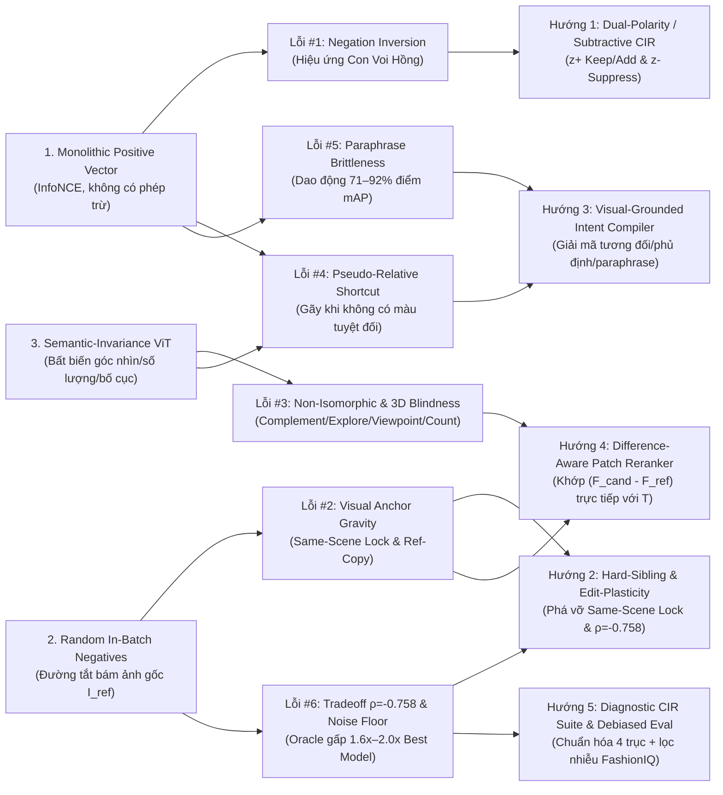

# Phân Tích Toàn Diện Các Điểm Gãy Phổ Quát Của Mô Hình CIR Hiện Tại & Đề Xuất Hướng Đi Nghiên Cứu

> [!IMPORTANT]
> Toàn bộ số liệu trong báo cáo này được tính trực tiếp từ **86 lượt đánh giá thực nghiệm** trên **16 kiến trúc CIR** thuộc 3 thế hệ (`Classic ResNet50`: `CLVC-Net`, `DCNet`; `CLIP`: `CLIP4Cir`, `ENCODER`, `TG-CIR`, `LIMN`; `BLIP-2`: `SPRC`, `MTST-PTHA`, `TME`, `CSMCIR`, `HINT`, `HABIT`, `INTENT`, `ConeSep`, `AirKnow`, và `QuRe` ICML 2025) trên **3 benchmark bổ trợ lẫn nhau**:
> - **EDIR** (`70_10_20_seed42`, `1,003` test queries, corpus `28,645` ảnh, `15` phép chỉnh sửa): `16` In-Domain + `11` CIRR Transfer + `15` FIQ Transfer = **`42` runs** (bit-exact `max_abs_diff = 0.00e+00`).
> - **PinPoint** (`70_10_20_seed42`, `1,337` test queries, corpus `109,598` ảnh, `23` lĩnh vực, `5` loại truy vấn có nhãn negative tường minh): `16` In-Domain + `15` FIQ Transfer = **`31` runs**.
> - **FashionIQ** (`6,016` val queries, `3` danh mục `dress/shirt/toptee`): **`13` modern CLIP/BLIP-2 in-domain runs** trong `workbench/artifacts/workbench.duckdb` (tách riêng theo từng protocol để loại trừ nhiễu giao thức).

---

## 1. Bức Tranh Tổng Thể: 3 Nguyên Nhân Gốc Rễ → 6 Điểm Gãy Phổ Quát → 5 Hướng Nghiên Cứu

Mặc dù các mô hình CIR đã tiến hóa mạnh từ ResNet/LSTM (2021) sang CLIP (2022–2023) và BLIP-2/Q-Former kèm học chống nhiễu & khai thác hard-negative (2024–2025), **cả 16 mô hình đều cùng vấp phải 6 điểm gãy mang tính hệ thống**. Nguyên nhân không nằm ở việc "thiếu backbone lớn hơn", mà xuất phát từ **3 giả định toán học ngầm sai lệch** trong thiết kế CIR hiện đại:

1. **Giả định Biểu diễn Đơn cực Dương (Monolithic Positive Dot-Product):** Gom toàn bộ truy vấn `(I_ref, T)` thành một vector duy nhất `q` rồi đo tương đồng dương `⟨q, t⟩` bằng InfoNCE — không có cơ chế toán học để *trừ*, *ức chế*, hay *triệt tiêu* thuộc tính bị phủ định.
2. **Giả định Đường tắt Đẳng cấu Thị giác (Isomorphic Visual-Identity Shortcut):** Huấn luyện contrastive với random in-batch negatives khiến model dễ dàng giảm loss bằng cách bám sát ảnh tham chiếu `I_ref` (`z_tgt ≈ z_ref + ε·Δ_text`), tạo ra lực hút "copy ảnh gốc" cực mạnh và phá hủy độ nhạy tinh vi với văn bản.
3. **Giả định Tiền huấn luyện Bất biến Ngữ nghĩa (Semantic-Invariance Pretraining):** Backbone CLIP/BLIP-2 được tiền huấn luyện để *bất biến* với góc nhìn, tỉ lệ, số lượng vật thể, và bố cục không gian — đúng thứ CIR cần *phân biệt chính xác*.

### Bảng Tóm Tắt Tỷ Lệ Lỗi Đồng Loạt (Universal Failure Floor) & Khoảng Trống Oracle

| Benchmark | Số query | Best Single Model | **Oracle Ensemble** | **Headroom chưa khai phá** | **0-Pass đồng loạt** (Tất cả model đều trượt) | **Đa số trượt (`≤25%` model đúng)** |
|---|---:|---:|---:|---:|---:|---:|
| **EDIR In-Domain** (`16` model, `R@1`) | 1,003 | `38.38%` (`MTST-PTHA`) | **`77.47%`** (`68.20%` BLIP-2) | **`+39.09%`** | `226` (**`22.53%`**) — **`95` (`9.47%`) trượt cả 42 runs!** | `614` (**`61.22%`**) |
| **PinPoint In-Domain** (`16` model, `mAP@10`) | 1,337 | `0.2128` (`ConeSep`*) | **`0.3487`** (`0.3317` BLIP-2) | **`+62%` tương đối** | `128` (**`9.57%`** có `0` pos@10; `12.79%` BLIP-2) — **`109` (`8.15%`) trượt cả 31 runs!** | `331` (**`24.76%`**) |
| **FashionIQ** (`13` modern runs, `R@10 / R@50`) | 6,016 | `57.05%` (`CSMCIR` orig) | **`78.32%` / `91.39%`** | **`+21.3%` R@10** | `1,304` (**`21.68%`** trượt `R@10`), `518` (**`8.61%`** trượt `R@50`) | `2,201` (**`36.59%`** trượt `R@10`) |

> [!NOTE]
> *Lưu ý ký hiệu:* Trên PinPoint, điểm `mAP@10` chính thức trong [LEADERBOARD_PINPOINT.md](../20261123-edir-pinpoint-splits/LEADERBOARD_PINPOINT.md) (`ConeSep = 0.2128`) dùng mẫu số `positive_ids_raw` khớp 100% mã nguồn gốc PinPoint; khi chuẩn hóa theo tập deduplicated `positive_ids` để phân tích per-query chi tiết bên dưới, mức chênh tuyệt đối chỉ là `~0.002` (`0.2148` vs `0.2128`) và không đổi bất kỳ thứ hạng hay kết luận nào.

---

## 2. Phân Tích Định Lượng Chuyên Sâu 6 Điểm Gãy Phổ Quát

### Điểm Gãy #1: Nghịch Lý Phủ Định & Loại Trừ ("Hiệu Ứng Con Voi Hồng" / Negation & Exclusion Inversion)

Đây là **lỗi nghiêm trọng nhất, nhất quán nhất và rõ ràng nhất về mặt cơ chế** trên cả 3 benchmark và cả 16 mô hình (bao gồm cả `QuRe` ICML 2025). Không chỉ đơn thuần "không hiểu phủ định", các mô hình còn **chủ động đảo ngược ý định người dùng**: càng nhắc đến vật thể cần xóa/loại trừ trong câu truy vấn (`"no candy cane"`, `"remove tie-dye"`, `"I don't want grey suede"`), mô hình càng **kéo embedding tiến gần hơn tới ảnh chứa đúng vật thể bị cấm đó**.

#### Chứng cứ 1A — EDIR: Không chỉ `remove`, mà mọi câu loại trừ ẩn trong 14 nhóm khác đều sụp đổ xuống dưới mức ngẫu nhiên (`16.67%`)

Mỗi cảnh EDIR gồm `6` ảnh biến thể gần nhau (`1` đích + `5` hard siblings). Nếu đoán mò trong 6 ảnh của cùng một cảnh, xác suất đúng là `1/6 = 16.67%`. Khi tách `1,003` câu test EDIR theo ngôn ngữ phủ định/loại trừ (trung bình trên `10` model BLIP-2 In-Domain, `7` model CIRR Transfer, `9` model FIQ Transfer):

| Nhóm truy vấn EDIR | Số query | ID-BLIP2 `R@1` (`CondR@1`) | CIRR-BLIP2 `R@1` (`CondR@1`) | FIQ-BLIP2 `R@1` (`CondR@1`) | Phân bố thứ hạng đích trong 6 anh em (ID-BLIP2: `Rk1 → Rk6`) |
|---|---:|---:|---:|---:|---|
| **Khẳng định (Affirmative, không phủ định)** | 822 | `32.24%` (`33.16%`) | **`40.30%` (`57.52%`)** | `35.86%` (`48.15%`) | `33.5% → 17.0% → 14.5% → 12.4% → 12.0% → 10.6%` *(giảm dần chuẩn)* |
| **Ngoài `remove`, có từ loại trừ (`don't want / except`)** | 105 | **`17.62%` (`17.85%`)** | `21.09%` (`27.51%`) | `19.05%` (`23.65%`) | `17.9% → 14.5% → 15.9% → 16.6% → 14.0% →` **`21.1%` (Đội sổ cao nhất!)** |
| **Nhóm `remove` (Xóa vật thể)** | 62 | **`17.58%` (`18.29%`)** | **`17.05%` (`21.63%`)** | **`14.70%` (`19.95%`)** | `19.7% → 14.6% → 11.8% → 16.6% →` **`18.4% → 19.0%` (`37.4%` ở đáy!)** |

> [!WARNING]
> **Bằng chứng "Active Inversion" (Đảo ngược chủ động):**
> - Trên `105` câu loại trừ ẩn nằm trong các nhóm `weather` (19), `time` (17), `texture` (15), `style` (15), `complex` (15), `color` (12), `material` (12), `shape` (11) — ví dụ *"I don't want the shoe to have grey suede"* (`#392`), *"I need the gemstone with a different material, except for smoky quartz or rough ruby"* (`#429`), *"I don't want the frosting to be plain"* (`#1056`) — **hạng 6/6 (bét bảng trong cụm!) là vị trí xảy ra nhiều nhất (`21.1%` > hạng 1 `17.9%`)**!
> - Trên `remove`, **`54.8%`** câu trượt cả 7 model CIRR-BLIP2 và **`62.9%`** trượt cả 9 model FIQ-BLIP2, đồng thời các model **đồng thuận tới `60.0%` vào CÙNG MỘT ảnh sai** (ví dụ `#1584` *"does not have a candy cane"*: `8/10` BLIP-2 ID và `5/7` CIRR chọn cùng một ảnh sai có candy cane; `#1506` *"Remove the ambulance"*: `6/10` ID và **`7/7`** CIRR chọn cùng ảnh sai!).

#### Chứng cứ 1B — PinPoint `Negation`: `70%–91%` Rank-1 là Ảnh Gốc hoặc Ảnh Bị Cấm Tường Minh!

Trên `53` truy vấn nhóm `Negation` của PinPoint (phân tách rạch ròi `Pos@1`, `RefCopy@1`, `NonRef-ExplicitNeg@1` — không đếm trùng):

| Thế hệ Model trên PinPoint `Negation` (`n=53`) | `mAP@10` | `mAP@10_noNeg` (nếu lọc bỏ neg) | **`Pos@1`** | **`RefCopy@1`** | **`NonRef-ExplicitNeg@1`** | **`AnyNonRefNeg` trong Top-10** | **`Neg > Pos` trong Top-10** | Trượt 100% (0 Pos@10 ở mọi model) |
|---|---:|---:|---:|---:|---:|---:|---:|---:|
| **BLIP-2 In-Domain (`10` model)** | `0.0986` | **`0.1807` (`+83%`!)** | **`4.34%`** | **`52.64%`** | **`17.74%`** | **`80.75%`** | **`73.58%`** | **`37.7%`** (`20/53`) |
| **CLIP In-Domain (`4` model)** | `0.0701` | `0.1188` | **`1.42%`** | **`83.96%`** | `7.55%` | **`83.49%`** | **`78.30%`** | — |
| **BLIP-2 FIQ Transfer (`9` model)** | `0.1302` | **`0.2209` (`+70%`!)** | `9.43%` | `42.14%` | **`26.00%`** | **`81.34%`** | **`67.71%`** | **`45.3%`** (`24/53`) |

- Ví dụ thực tế trượt `10/10` BLIP-2 (cả `10/10` đưa **explicit negative lên ngay Rank 1** và `0` positive trong Top-10):
  - `query_06179`: *"Remove the tie-dye pattern from the cardigan, making it a solid blue."*
  - `query_06183`: *"Change the cardigan in the image by eliminating the tie dye pattern and rendering it a single blue tone"*
  - `query_03565`: *"Can you show this tee with the primary print removed?"*
- Thậm chí ngay trên `QuRe` (ICML 2025, chuyên khai thác hard negative), `PinPoint Negation` In-Domain vẫn sụp xuống **`0.0402`** (`Fashion-Negation = 0.0033`!).

#### Chứng cứ 1C — FashionIQ: Phủ định không kèm màu tuyệt đối giảm **`-29.42%` R@10**

- Trên `6,016` câu FashionIQ (trung bình `13` modern runs): nhóm `negation_WITHOUT_absolute_color` (`n=236`) chỉ đạt **`R@10 = 34.88%`**, `ALL13_Fail@50 = 18.64%` — thấp hơn **`-29.42%`** so với nhóm `absolute_color_NO_comparative` (`R@10 = 64.30%`, `ALL13_Fail@50 = 4.80%`).

---

### Điểm Gãy #2: Lực Hút Neo Thị Giác, Sụp Đổ Nội Cảnh (`Same-Scene Lock`) & Bẫy Copy Ảnh Gốc (`Ref-Copy Gravity`)

Điểm gãy này giải thích một trong những kết quả gây sốc nhất toàn bộ thực nghiệm: **Tại sao fine-tune In-Domain trên EDIR lại làm `R@1` của `9/11` mô hình TỤT `-4%` đến `-14.4%` so với bản CIRR Transfer chưa từng thấy EDIR, trong khi `R@10` tăng vọt lên `98.4%`?**

#### Chứng cứ 2A — Giải phẫu toán học Nghịch lý EDIR (`Same-Scene Lock`)

| Chế độ (Trung bình nhóm BLIP-2) | `R@1` | **`SameSceneWrong@1`** *(Đúng cảnh, sai biến thể!)* | `DiffScene@1` *(Sai cảnh)* | `Scene@1` *(Đúng cảnh ở Top-1)* | **`CondR@1 \| Scene@1`** *(Độ chính xác sửa ảnh thuần túy)* | Số anh em cùng cảnh trong Top-6 |
|---|---:|---:|---:|---:|---:|---:|
| **EDIR In-Domain (`10` BLIP-2)** | `29.81%` | **`67.52%`** (`58.6%–73.6%`) | **`2.67%`** (`1.1%–5.4%`) | **`97.33%`** (`94.6%–98.9%`) | **`30.63%`** (`25.5%–39.6%`) | **`5.50 / 6`** (`5.11–5.71`) |
| **CIRR Transfer (`7` BLIP-2)** | **`36.87%`** | `34.85%` | `28.28%` | `71.72%` | **`51.66%`** (`46.3%–54.6%`) | `3.22 / 6` |
| **FIQ Transfer (`9` BLIP-2)** | `32.78%` | `42.45%` | `24.77%` | `75.23%` | **`43.59%`** (`36.9%–45.9%`) | `3.78 / 6` |

- **Cơ chế gốc rễ đã được chứng minh bằng dữ liệu train:** Tập train EDIR có `3,500` truy vấn trải trên **`3,347` cảnh độc lập** (trung bình chỉ `1.05` query/cảnh). Khi huấn luyện InfoNCE/CE với random in-batch negatives, **`99.97%` negative trong batch thuộc các cảnh hoàn toàn khác**, gần như **0%** là `5` hard siblings cùng cảnh!
- Do đó, mô hình lập tức đi **Đường tắt Nhận diện Thị giác (Visual-Identity Shortcut)**: đẩy sát embedding của truy vấn về phía đặc trưng toàn cục của ảnh gốc `I_ref`. Kết quả: `Scene@1` vọt lên **`98.9%`** (nhét `5.71 / 6` anh em vào Top-6), nhưng năng lực phân biệt đúng phép sửa bên trong cụm (`CondR@1`) bị **bóp nát từ `51.7%` (CIRR) xuống `30.6%` (ID)** — đặc biệt trên `replace` (`82.0% → 35.2%`, tụt **`-46.8%`**!) và `addition` (`76.8% → 38.6%`, tụt **`-38.2%`**!).
- Ngay cả **`QuRe` (ICML 2025)** dù có hard-negative mining toàn cục theo epoch vẫn bị kẹt `SameSceneWrong = 68.99%` (`5.59/6` anh em trong Top-6, `CondR@1 = 29.67%`) vì cơ chế hai bước dốc (two-steepest-drop) lọc bỏ các ảnh có độ tương đồng quá cao xung quanh target để tránh false negative — vô tình **bảo vệ luôn 5 hard siblings cùng cảnh khỏi bị đẩy ra xa!**

#### Chứng cứ 2B — Bẫy Copy Ảnh Tham Chiếu (`Ref-Copy Gravity`) trên PinPoint & FashionIQ

Trên PinPoint, ảnh tham chiếu `ref_id` nằm trong corpus `109,598` ảnh cho `1,337/1,337` truy vấn và được gán nhãn **explicit negative** trong `783/1,337` (`58.6%`) truy vấn:
- **Nhóm CLIP In-Domain (`LIMN`, `ENCODER`, `TG-CIR`, `CLIP4Cir`):** **`68.42%` toàn bộ Rank-1 là chính ảnh tham chiếu chưa hề chỉnh sửa!** (`83.96%` ở `Negation`, `74.24%` ở `Explore`, `73.57%` ở `Complement`), và **`85.9% – 92.5%`** truy vấn có ảnh gốc nằm trong Top-10!
- **Nhóm BLIP-2 In-Domain (`10` model):** Trung bình **`29.66%` Rank-1 vẫn là ảnh tham chiếu gốc** (`52.64%` ở `Negation`, `45.76%` ở `Explore`, `29.99%` ở `Swap`), và **`46.2% – 72.6%`** truy vấn kéo ảnh gốc vào Top-10! (Các model iLearn như `AirKnow` `72.6%`, `CSMCIR` `72.0%`, `QuRe` `68.2%`, `ConeSep` `66.0%` bị hút về ảnh gốc mạnh hơn nhiều so với `SPRC` `46.2%` và `TME` `52.6%`).
- **FashionIQ (`original_split` — giao thức KHÔNG ẩn ảnh gốc):** Lỗi này thường bị che giấu bởi `val_split` và `full_gallery_ref_excluded` (cố tình mask `ref_id`), nhưng trên `original_split`, **`CLIP4Cir` kéo ảnh gốc vào Top-10 ở `49.45%` query**, `QuRe` **`36.25%`**, `CSMCIR` **`35.95%`**, `TME` **`28.46%`**, `SPRC` **`22.29%`**!

#### Chứng cứ 2C — Nghịch Lý Nghịch Tương Quan Liên Benchmark (`ρ = -0.758` — Thế Lưỡng Nan Bảo Toàn vs Biến Đổi)

Tính hệ số tương quan hạng Spearman giữa 10 model **BLIP-2** trên 5 chế độ:
- **`EDIR In-Domain` vs `PinPoint In-Domain`: `ρ = -0.758` (nghịch tương quan cực mạnh!!)**
- **`EDIR In-Domain` vs `EDIR CIRR Transfer`: `ρ = -0.571` (nghịch tương quan!)**
- **`EDIR CIRR Transfer` vs `PinPoint FIQ Transfer`: `ρ = +0.714` (đồng thuận mạnh ở năng lực tổng quát hóa!)**

> [!IMPORTANT]
> **Phát hiện mang tính bản chất (The Visual-Preservation vs. Edit-Plasticity Dilemma):**
> - Các model thắng **PinPoint In-Domain** (`ConeSep #1`, `CSMCIR #2`, `INTENT #3`, `AirKnow #4`) có lực neo thị giác mạnh + cơ chế làm mịn chống nhiễu nhãn — rất tốt để giữ ngữ cảnh ổn định trên `109k` ảnh nhiều positive, nhưng lại thua nặng trên EDIR In-Domain (`#11`, `#10`, `#9`, `#6`) vì rơi vào `Same-Scene Lock` (`5.71/6` anh em).
> - Ngược lại, các model thắng **EDIR In-Domain** (`MTST-PTHA #1`, `SPRC #2`, `TME #3`) có cơ chế điều biến văn bản / multi-token / prompt sắc nét hơn (`RefCopy@1` thấp hơn một nửa: `7.3%–9.9%` vs `15%–20%`), phá vỡ neo thị giác tốt hơn nhưng lại kém hơn ở PinPoint (`#9`, `#7`, `#5`). **Hiện chưa có kiến trúc CIR nào dung hòa được đồng thời cả hai cực này!**

---

### Điểm Gãy #3: Sụp Đổ Trước Phép Biến Đổi Phi Đẳng Cấu, Đa Chủng Loại & Hình Học 3D / Đếm Số Lượng

Tất cả các mô hình CIR hiện tại đều hoạt động tốt nhất khi ảnh đích `I_tgt` **cùng chủng loại, cùng góc chụp, cùng khung hình** với ảnh gốc `I_ref` và chỉ thay đổi thuộc tính bề mặt (màu sắc, thêm/thay vật thể nổi bật). Khi truy vấn phá vỡ tính đẳng cấu này, **cả 16 model đồng loạt gãy**:

#### 3A. Sụp đổ Cross-Category & Pragmatic Intent trên PinPoint (`Complement`, `Explore`, `Context Fit`)

| Nhóm truy vấn PinPoint (`10` BLIP-2 In-Domain) | `n` | `mAP@10` (Max) | `Pos@1` | `RefCopy@1` | `0 Pos` trong Top-10 | Trượt 10/10 BLIP-2 | Bản chất truy vấn bị gãy |
|---|---:|---:|---:|---:|---:|---:|---|
| **`Complement`** *(Phối đồ / vật bổ trợ khác loại)* | 70 | **`0.0788`** (`0.1312`) | `14.57%` | `24.57%` | **`49.14%`** | **`25.7%`** | *"What understated blue decor would suit this kitchen?"* → Model trả về **căn bếp khác**, không trả đồ decor xanh! |
| **`Explore`** *(Hướng dẫn / nguồn mua / thông tin)* | 33 | **`0.0815`** (`0.1157`) | `11.52%` | **`45.76%`** | `42.73%` | `12.1%` | *"Show me how to make the item in the image"* (`10/10` trả explicit negative là ảnh thành phẩm!) |
| **`Negation`** *(Phủ định thuộc tính)* | 53 | **`0.0986`** (`0.1445`) | **`4.34%`** | **`52.64%`** | **`54.72%`** | **`37.7%`** | *"Remove the tie-dye pattern..."* (`10/10` trả đồ tie-dye!) |
| **`Context Fit`** *(Đặt vào bối cảnh/cấu trúc mới)* | 508 | `0.1661` (`0.1909`) *(FIQ-Tr: `0.0943`)* | `24.41%` | `26.50%` | `31.14%` | `11.4%` | *"Redesign this dining area for floor seating"* (`10/10` trả bàn ăn ghế cao thông thường!) |
| **`Swap`** *(Thay thuộc tính cục bộ — sân nhà CIR)* | 673 | **`0.2114`** (`0.2549`) | `25.42%` | `29.99%` | `28.97%` | `10.5%` | Gần FashionIQ nhất; vẫn gãy trên đổi cực nhỏ cục bộ (*"only the sandal's sole to neon green"*) |

- Về mặt lĩnh vực trên PinPoint (`23` domains): model đạt cao ở các thực thể có đặc trưng thị giác toàn cục sắc nét như `Vehicles` (`0.4035`), `Animals` (`0.3101`), `Men's Fashion` (`0.2358`), nhưng **gãy nặng ở lĩnh vực tinh vi/trừu tượng/chức năng**: `Health` (`0.0045`, `NegRec=0.323`), `Parenting` (`0.0072`), `Event Planning` (`0.0125`), `Education` (`0.0391`, `NegRec=0.308`), `Electronics` (`0.0400`), **`Beauty` (`0.0889`, `n=116`)**, và **`Women's Fashion` (`0.1379`, `n=299`)**!

#### 3B. Mù Hình Học 3D, Góc Nhìn (`viewpoint`), Hình Dạng (`shape`) & Đếm Số Lượng (`cardinality`) trên EDIR

Xếp hạng `15` phép chỉnh sửa trên EDIR cho thấy **hai cực đối lập hoàn toàn** giữa *thuộc tính ngữ nghĩa danh từ* và *biến đổi hình học/đếm/bề mặt*:
- **Nhóm làm tốt (CIRR-BLIP2 `CondR@1`):** `replace` (`81.99%`), `addition` (`76.83%`), `action` (`73.76%`), `color` (`67.68%`), `time` (`64.82%`).
- **Nhóm sụp đổ toàn diện trên cả 3 chế độ (`ID / CIRR / FIQ`):**
  1. **`remove`**: `17.58%` / `17.05%` / `14.70%` (`0-pass`: `48%–63%`).
  2. **`viewpoint`** (*"zoom in slightly on the Pope's face"*, *"wider angle"*, *"above the glass"*): **`25.00%` / `24.05%` / `19.26%`** (`0-pass`: `45%–47%`, **`12` câu trượt cả 42 runs** — ngang bằng `remove`!).
  3. **`shape`** (*"slightly rounded cover"*, *"round the corners"*): `24.10%` ID / `27.69%` FIQ.
  4. **`cardinality`** (*"reduce RAM modules to one"*, *"add one more frame"*, *"fewer okra pods"*): `25.61%` ID / `31.83%` CIRR (`40.4%–47.4%` 0-pass!).
  5. **`material` / `style` / `texture`**: `24.26% – 28.36%` ID, `27.01% – 33.26%` CIRR.

---

### Điểm Gãy #4: Ảo Giác "Suy Luận Tương Đối" (Pseudo-Relative Shortcut) & Nhiễu Đa Ràng Buộc (Multi-Constraint Interference)

Một phát hiện cực kỳ quan trọng từ kiểm định có đối chứng trên `6,016` truy vấn FashionIQ: **Các mô hình CIR hiện tại thực chất KHÔNG giỏi tính toán phép biến đổi tương đối (`I_ref + Δ_relative`), mà chủ yếu dựa vào đường tắt khớp thuộc tính tuyệt đối từ văn bản!**

| Phân tầng ngôn ngữ trên FashionIQ (`6,016` queries, trung bình `13` modern runs) | `n` (`%`) | `Mean R@10` | `Mean R@50` | **`ALL13 Fail@50`** | Chênh lệch `R@10` |
|---|---:|---:|---:|---:|---:|
| **Có màu tuyệt đối, KHÔNG có từ so sánh** (`absolute_color_NO_comparative`) | 1,604 (`26.7%`) | **`64.30%`** | **`83.39%`** | `4.80%` | *Baseline chuẩn* |
| **Có màu tuyệt đối + có từ so sánh** (`comparative_WITH_absolute_color`) | 2,731 (`45.4%`) | `55.00%` | `77.26%` | `6.44%` | `-9.30%` |
| **Chỉ có từ so sánh, KHÔNG có màu tuyệt đối** (`comparative_WITHOUT_absolute_color`) | 1,410 (`23.4%`) | **`38.09%`** | **`59.48%`** | **`16.81%` (3.5×!)** | **`-26.21%`!!** |
| **Phủ định, KHÔNG có màu tuyệt đối** (`negation_WITHOUT_absolute_color`) | 236 (`3.9%`) | **`34.88%`** | **`57.56%`** | **`18.64%` (3.9×!)** | **`-29.42%`!!** |

- **Giải thích:** Khi caption viết *"is red and longer"*, model chỉ cần tìm váy màu `"red"` giống form `I_ref` (`R@10 = 55%–64%`). Nhưng khi caption chỉ viết tương đối (*"is darker"*, *"has shorter sleeves"*, *"more casual"*, *"less fitted"*) buộc model phải **đo trạng thái hiện tại của `I_ref` rồi dịch chuyển theo hướng tương đối**, hiệu năng sụp thẳng **`-26.2%` R@10**!
- **Nhiễu đa ràng buộc trên PinPoint (`Short → Long`):** Trái ngược với FashionIQ (dài = liệt kê thêm thuộc tính tuyệt đối), trên PinPoint khi câu lệnh tự nhiên dài và chứa đồng thời nhiều ràng buộc giữ/xóa/đổi:
  - `len_short`: `mAP@10 = 0.2087`, `NegRec@10 = 0.1145`
  - `len_medium`: `mAP@10 = 0.1749`, `NegRec@10 = 0.1309`
  - **`len_long`**: **`mAP@10 = 0.1638` (`-21.5%` tương đối)**, trong khi **`NegRec@10` tăng vọt lên `0.1479` (`+29.2%` negative!)**.
  - Ví dụ trượt `10/10` BLIP-2: *"Transform the hair shown in the provided image by removing the finger wave texture and rendering it as a neat, uniform lavender buzz cut"* (`query_06430`, `10/10` đưa explicit negative lên Rank 1!) và *"Please render the building with the same silhouette, glazing approach, and lighting mood as the reference, converting the entire exterior from its current material to wood"* (`query_02949`, `9/10` explicit negative ở Rank 1!).

---

### Điểm Gãy #5: Độ Giòn Ngôn Ngữ Cực Độ Trước Paraphrase (Linguistic Paraphrase Brittleness)

PinPoint chứa **`258` nhóm ý định trùng khớp hoàn toàn** (`1,285` truy vấn có **cùng ảnh tham chiếu** và **cùng tập ảnh đích**, chỉ khác cách diễn đạt câu chữ). Kết quả đo độ dao động `mAP@10` giữa câu diễn đạt tốt nhất và tệ nhất trong cùng một nhóm ý định là **cực kỳ báo động**:

| Model (PinPoint In-Domain) | `mAP@10` toàn cục | Biên độ dao động Paraphrase (`mean range`) | **Tỷ lệ dao động / tổng `mAP@10`** | Nhóm ý định lật hoàn toàn từ `0.0 → >0` chỉ do đổi cách diễn đạt |
|---|---:|---:|---:|---:|
| **`ConeSep`** (#1 toàn bảng) | `0.2128` *(0.2148 dedup)* | `0.1521` *(official `0.1746`)* | **`70.8%` (`82.0%` official!)** | `52 / 258` (**`20.2%`**) |
| **`CSMCIR`** (#2) | `0.1963` | `0.1471` *(official `0.1737`)* | **`74.4%` (`88.5%` official!)** | `59 / 258` (**`22.9%`**) |
| **`INTENT`** (#3) | `0.1929` | `0.1526` *(official `0.1661`)* | **`78.3%` (`86.1%` official!)** | `56 / 258` (**`21.7%`**) |
| **`AirKnow`** (#4) | `0.1891` | `0.1280` *(official `0.1589`)* | `67.0%` (`84.0%` official) | `66 / 258` (**`25.6%`**) |
| **`TME`** (#5) | `0.1781` | `0.1653` *(official `0.1924`)* | **`92.1%` (`108%` official!)** | **`74 / 258` (`28.7%`)** |
| **`QuRe`** (ICML 2025) | `0.1401` | `0.1146` *(official `0.1527`)* | **`80.6%` (`109%` official!)** | `65 / 258` (**`25.2%`**) |

**Ví dụ thực tế ngay trên mô hình #1 toàn bảng `ConeSep` (`16/258` nhóm có bước nhảy `≥ 0.50 mAP@10`):**
- **Swing `+0.963`:** *"edit the coat of the horse shown, **erasing black markings** to achieve a uniform white color"* → **`0.037`** **vs** *"make the pictured horse **pure white**"* → **`1.000`**! *(Nhắc tới `"black markings"` lập tức kích hoạt bẫy Con Voi Hồng!)*
- **Swing `+0.801`:** *"Make the flare on the jeans **more exaggerated**."* → **`0.036`** **vs** *"increase the flare on the blue denim jeans from a mild boot cut to **very wide bell bottoms**"* → **`0.837`**! *(Tương đối mơ hồ thất bại; tên khái niệm đích tường minh `"bell bottoms"` thắng tuyệt đối!)*
- **Swing `+1.000`:** *"...rendered with a **textured textile approach**."* → **`0.000`** **vs** *"...convert the material ... to a **tweed weave**..."* → **`1.000`**!

> [!TIP]
> **Gợi ý nghiên cứu cực sắc bén:** Các model CIR hiện tại không thiếu khả năng nhận diện khái niệm đích (`mAP@10 = 1.000` khi viết đúng từ khóa thị giác!), mà **thiếu tầng suy luận chuyển đổi ý định (Intent-to-Visual-Target Grounding)** để dịch các biểu thức phủ định, tương đối, trừu tượng sang đặc tả thị giác đích cụ thể!

---

### Điểm Gãy #6: Tách Bạch "Nhiễu Benchmark" Khỏi "Lỗi Thực Của Model" (Tránh Bẫy Khi Làm Research)

Trước khi chọn hướng nghiên cứu, cần tách rạch ròi phần **không thể giải bằng model** (nhiễu nhãn của FashionIQ) khỏi phần **dư địa thật sự**:

1. **Nhiễu False Negative trên FashionIQ (đo bằng Top-10 Jaccard giữa các model khác kiến trúc):**
   - Trong `951` câu mà cả 4 model BLIP-2 khác nhau (`CSMCIR`, `TME`, `QuRe`, `SPRC` trên `original_split`) đều trượt `R@50`, có tới **`34.3%` câu có độ đồng thuận Top-10 Jaccard `≥ 0.30`** — tức là 4 model độc lập cùng chọn chung một nhóm áo/váy hợp lý, chỉ là không trúng duy nhất 1 `target_id` được gán nhãn! (Trên `4` model cùng họ iLearn ở `full_gallery`, tỷ lệ này lên tới `85.0%`).
2. **Xung đột & Thiếu thông tin của Dual-Caption trên FashionIQ (`6,016` queries):**
   - `3,586 / 6,016` (`59.6%`) truy vấn có **2 caption không trùng nhau bất kỳ từ nội dung nào** → `R@10 = 49.78%` vs **`61.31%`** (`-11.53%`) khi 2 caption có giao nhau một phần (`0 < J < 0.25`).
   - Có ít nhất **`73` truy vấn chứa từ trái nghĩa trực tiếp giữa 2 caption** — ví dụ `shirt:698` (`["is button-up and plaid", "is t shirts with no buttons"]`, median rank `5,634`), `dress:1400` (`["is shorter and sexier with no sleeves", "The dress is longer and less summery"]`, median rank `2,441`) → `R@10` tụt xuống **`28.45%`**, `ALL13_Fail@50 = 28.77%`.
   - `445` truy vấn (`7.4%`) siêu ngắn (`≤ 6` từ, ví dụ `shirt:1053`: `["is a shirt", "is a shirt"]`) → `R@10 = 41.37%`, `ALL13_Fail@50 = 16.18%`.
3. **Kết luận phương pháp luận:** **Không nên chỉ chạy đua tăng +0.5% trên FashionIQ** (nơi trần sạch đã dần bão hòa và bị chi phối bởi false negatives + dual-caption noise). Giá trị khoa học cao nhất hiện nay nằm ở **EDIR (`CondR@1`, `remove`, `viewpoint`, `cardinality`)** và **PinPoint (`Negation`, `Complement`, `Explore`, `NegRecall@10`, `ling_sens_range`)** — nơi headroom còn **rộng gấp `1.6× – 2.0×`** và mọi lỗi đều là lỗi nhận thức thật của mô hình!

---

## 3. Đề Xuất 5 Hướng Đi Research Đột Phá Trong Lĩnh Vực CIR

Dưới đây là **5 đề tài nghiên cứu cụ thể**, mỗi đề tài đánh thẳng vào 1–2 điểm gãy phổ quát đã được chứng minh bằng số liệu ở Mục 2, có **câu hỏi khoa học rõ ràng, cơ chế toán học mới, và kiểm chứng được ngay trên Workbench 16-model này**.

---

### Hướng 1 (Khuyến nghị #1 — Novelty cao nhất, dễ bảo vệ ở CVPR/ICCV/ICML): **Dual-Polarity / Subtractive Composed Image Retrieval (`Keep-Add` vs `Suppress-Negate`)**

- **Đánh thẳng vào:** **Lỗi #1 (Negation Inversion)** + **Lỗi #2 (Ref-Copy Gravity)** + giảm mạnh `NegRecall@10`.
- **Khoảng trống khoa học:** Mọi phương pháp CIR hiện nay (từ CLIP4Cir đến SPRC, ConeSep, QuRe) đều mã hóa truy vấn thành một vector đơn cực `q ∈ ℝ^d` và xếp hạng bằng `⟨q, t⟩`. Vector đơn cực về mặt hình học **không thể đồng thời biểu diễn** *"giữ nguyên cardigan xanh nhưng CẤM có họa tiết tie-dye"* hoặc *"giữ cảnh này nhưng XÓA xe cứu thương"* mà không bị hiệu ứng Con Voi Hồng.
- **Ý tưởng cốt lõi:**
  - Phân rã đầu ra của Q-Former / Multi-Token Composer thành **2 nhánh có cực tính đối nghịch** (hoặc 1 vector dương + 1 không gian con ức chế):
    1. **`z^+ = f^+(I_ref, T)`**: đặc trưng cần **giữ và thêm** (target representation).
    2. **`z^- = f^-(I_ref, T)`**: đặc trưng cần **ức chế / loại trừ** (forbidden attribute / removed object / stale reference feature), kèm cổng kiểm soát cường độ phủ định `g_neg(T) ∈ [0, 1]` và cổng thoát neo ảnh gốc `g_ref(I_ref, T)`.
  - **Hàm tính điểm có dấu (Signed / Orthogonalized Scoring)** vẫn tương thích tìm kiếm nhanh ANN/MIPS (`O(2d)`):
    $$S(q, t) = \langle z^+, t \rangle - \lambda \cdot g_{\text{neg}}(T) \cdot \max\!\big(0,\, \langle z^-, t \rangle - \tau\big) - \gamma \cdot g_{\text{ref}}(I_{\text{ref}}, T) \cdot \mathbb{I}[t \approx I_{\text{ref}}]$$
    hoặc chiếu trực giao `z^+` ra khỏi không gian con sinh bởi `z^-`: `z_clean = normalize(z^+ - β·proj_{z^-}(z^+))`.
  - **Hàm mất mát huấn luyện (Counterfactual Triplet / Negative-Margin InfoNCE):** Sử dụng trực tiếp các hard negatives có sẵn (`negative_ids` trên PinPoint & `5` hard siblings trên EDIR) + **tổng hợp dữ liệu phủ định nghịch đảo tự động** từ các cặp `(I_ref, T_add, I_tgt)` sẵn có bằng cách đảo ngược `(I_tgt, "remove ...", I_ref)` kèm `I_tgt` làm **explicit forbidden negative**!
- **Tác động kỳ vọng (có cơ sở số liệu):** Trên PinPoint `Negation`, chỉ riêng việc đẩy lùi explicit negative đã mở khóa **`+83%` relative gain (`0.0986 → 0.1807`)**; trên EDIR `remove` + `105` câu exclusion ẩn (`16.6%` toàn bộ EDIR!), phá vỡ mức sàn ngẫu nhiên `17.6%` lên `35%–50%` sẽ tạo ra bước nhảy chưa từng có trong văn liệu CIR.

---

### Hướng 2 (Khuyến nghị #2 — Giải quyết bài toán hệ thống lớn): **Decoupled Scene-vs-Edit Learning & Adaptive Edit-Plasticity (Phá vỡ `Same-Scene Lock` & Nghịch lý `ρ = -0.758`)**

- **Đánh thẳng vào:** **Lỗi #2 (Same-Scene Lock & EDIR Fine-Tuning Paradox)** + **Lỗi #6 (Nghịch tương quan `ρ = -0.758` giữa EDIR và PinPoint)**.
- **Khoảng trống khoa học:** Chúng ta vừa chứng minh bằng số liệu rằng fine-tune CIR chuẩn với random in-batch negatives rơi vào đường tắt `Visual-Identity Shortcut` (`Scene@1 = 98.9%` nhưng `CondR@1` sụp từ `51.7% → 30.6%`), còn `QuRe` (ICML 2025) lọc false negative toàn cục nên vô tình tha cho các hard siblings cùng cảnh. Đồng thời, các kiến trúc cố định trọng số giữa `I_ref` và `T` bị kẹt trong thế lưỡng nan: neo ảnh mạnh thì thắng PinPoint nhưng thua EDIR, neo yếu thì ngược lại (`ρ = -0.758`).
- **Ý tưởng cốt lõi:**
  1. **Two-Scale Contrastive Objective (Coarse In-Batch + Fine Intra-Scene/Hard-Attribute Margin):** Tách rõ loss toàn cục (tìm đúng cụm cảnh, nhiệt độ `τ_coarse`) và loss phân biệt tinh vi (chỉ tính giữa `I_tgt` với `hard siblings` / `attribute-conflicting negatives` trong cùng cảnh hoặc gần nhất với `I_ref`, kèm **text-gradient preservation regularization** chống quên tri thức ngữ nghĩa khi fine-tune trên tập nhỏ như EDIR `3.5k` queries).
  2. **Dynamic Edit-Plasticity Router (`α(I_ref, T)`):** Thay vì trộn `I_ref` và `T` theo tỷ lệ tĩnh, học một bộ định tuyến dự đoán **mức độ rời xa ảnh gốc** dựa trên bản chất phép sửa:
     - `Swap` / `EDIR local edit` → giữ neo thị giác cao, tập trung delta cục bộ.
     - `Complement` / `Explore` / `Context Fit` / `Negation` → giảm mạnh trọng số bảo toàn pixel/layout của `I_ref`, chuyển sang bảo toàn *ngữ cảnh/phong cách trừu tượng* (`style/palette`) thay vì *đẳng cấu vật thể*.
- **Tác động kỳ vọng:** Trở thành mô hình đầu tiên đứng **Top-1 đồng thời trên cả EDIR In-Domain (`>45% R@1`), EDIR Transfer (`>43%`), lẫn PinPoint (`>0.23 mAP@10`)**, trực tiếp phá vỡ đường biên Pareto `ρ = -0.758`.

---

### Hướng 3 (Khuyến nghị #3 — Xu hướng 2025–2026 cực nóng, tiềm năng ứng dụng cao): **Visual-Grounded Intent Canonicalization (VLM Query Compiler giải quyết Relative, Negation & Paraphrase Brittleness)**

- **Đánh thẳng vào:** **Lỗi #4 (Pseudo-Relative Shortcut `-26.2%`)** + **Lỗi #5 (Paraphrase Brittleness `71%–92%` swing)** + **Lỗi #3 (`Complement` / `Explore`)**.
- **Khoảng trống khoa học:** Bằng chứng trực tiếp trên `ConeSep` (#1 PinPoint) cho thấy: cùng một truy vấn và cùng một retriever đóng băng, chỉ cần chuyển câu phủ định/tương đối (*"erasing black markings..."* → *"pure white"*; *"more exaggerated flare"* → *"very wide bell bottoms"*) đã nhảy từ **`0.036 → 1.000 mAP@10`**. Các phương pháp Query Rewriting chỉ dùng text-only LLM thất bại vì **không nhìn thấy ảnh gốc `I_ref`** (không biết áo trong ảnh đang màu gì/dài tới đâu để dịch *"darker"* hay *"shorter sleeves"* thành đặc tả đích cụ thể!).
- **Ý tưởng cốt lõi:**
  - Xây dựng một **Visual-Grounded Intent Compiler** (dùng VLM gọn 3B–7B như Qwen2.5-VL ở chế độ train-free / LoRA / hoặc distill thành lightweight adapter) nhận đầu vào `(I_ref, T)` và biên dịch thành **3 trường chuẩn hóa trực quan (Canonical Visual Spec)**:
    1. `Target_Positive_Desc`: Mô tả tường minh trạng thái đích sau khi đã giải mã từ so sánh tương đối dựa trên `I_ref` (vd nhìn thấy váy dài màu xanh nhạt + *"darker and shorter"* → *"knee-length navy blue dress"*).
    2. `Forbidden_Attributes`: Danh sách thuộc tính bị xóa/phủ định (vd *"tie-dye pattern"*, *"candy cane"*) để đưa vào nhánh ức chế (kết hợp mượt với **Hướng 1**!) hoặc làm bộ lọc rerank.
    3. `Retention_Scope`: Xác định phạm vi giữ lại (`pixel_scene`, `object_category`, `style_only`, hay `cross_category_complement`).
  - **Đóng góp khoa học (tránh bị chê "chỉ là prompt engineering"):**
    - Chứng minh lý thuyết & thực nghiệm rằng **Paraphrase Variance (`ling_sens_range`)** sụp giảm mạnh (từ `0.17` xuống `<0.06`) khi chuẩn hóa về Canonical Visual Spec.
    - **Distillation về single-pass encoder** (hoặc **Test-Time Self-Consistency Ensembling** qua tập paraphrase chuẩn hóa) để giữ độ trễ thấp trong production!
- **Tác động kỳ vọng:** Có thể kiểm chứng bản prototype ngay trong **1–2 tuần** trên toàn bộ `EDIR + PinPoint + FashionIQ` (plug-and-play lên trên `ConeSep` / `INTENT` / `QuRe`), nhắm thẳng vào mức giảm `>50%` paraphrase instability và `+10%–20%` trên lát cắt `comparative_WITHOUT_color`, `Negation`, `Complement`, `Explore`.

---

### Hướng 4 (Khuyến nghị #4 — Chuyên trị Fine-Grained Geometry, Viewpoint, Counting & Top-10 Intra-Scene Discrimination): **Difference-Aware Patch-Level Reranking (`Δ-Visual Alignment`)**

- **Đánh thẳng vào:** **Lỗi #2 (`R@10 = 98.4%` vs `R@1 = 28%–38%` trên EDIR)** + **Lỗi #3 (`viewpoint`, `shape`, `cardinality`, `remove`, `spatial`)**.
- **Khoảng trống khoa học:** Trên EDIR In-Domain, **`96.5% – 98.4%` ảnh đích đã nằm sẵn trong Top-10** (và `99.6%` trong Top-50!), còn trên PinPoint, **`>95%` query có positive trong Top-50** (nếu tính theo tập Oracle BLIP-2). Nút thắt cổ chai không còn là truy hồi thô (coarse recall), mà là **xếp hạng lại Top-K dựa trên sự khác biệt thị giác tinh vi**. Một bi-encoder mã hóa độc lập `g(I_cand)` không bao giờ nhìn thấy *sự khác biệt trực tiếp* giữa `I_cand` và `I_ref` (nên mù trước *"zoom in slightly"*, *"add one more frame"*, *"round the corners"*, *"remove watermark"*).
- **Ý tưởng cốt lõi:**
  - Thiết kế **Stage-2 Difference-Aware Cross-Modal Reranker** siêu nhẹ chạy trên Top-`K` (`K=10` hoặc `20`) ứng viên:
    - Trích đặc trưng patch không gian `F_ref, F_cand ∈ ℝ^{N×d}` (từ cùng backbone ViT/DINOv2 — không cần encode lại ảnh toàn corpus!).
    - Tính **bản đồ sai khác có định hướng (Directional Patch Difference / Cross-Image Patch Correspondence)**: xác định vùng patch nào **mất đi** (`F_ref \ F_cand` → khớp trực tiếp với `remove` / `Negation`!), vùng patch nào **xuất hiện mới** (`F_cand \ F_ref` → khớp `addition` / `replace`!), và trường dịch chuyển không gian/tỉ lệ (`patch flow` → khớp `viewpoint` / `spatial` / `shape`!).
    - Đối chiếu trực tiếp bộ ba `(F_ref, F_cand, ΔF)` với văn bản `T` để chấm điểm listwise trên Top-K.
- **Tác động kỳ vọng:** Trên EDIR (nơi `R@10 ≈ 98%`), đây là hướng có khả năng đẩy `R@1` từ trần hiện tại `38.4%` lên **`55%–70%+`** (đặc biệt trên `remove`, `viewpoint`, `shape`, `cardinality`), đồng thời cắt giảm mạnh `RefCopy@1` và `NegRecall@10` trên PinPoint (vì `ΔF = 0` khi `I_cand == I_ref`, mô hình nhận ra ngay ứng viên chưa hề thay đổi gì!).

---

### Hướng 5 (Hướng Bench & Resource Track — NeurIPS Datasets & Benchmarks / ICCV): **Diagnostic CIR Evaluation & Debiased Multi-Axis Protocol**

- **Đánh thẳng vào:** **Lỗi #6 (Benchmark Noise, Hidden Ref-Masking Bias & Single-Metric Blindness)**.
- **Ý tưởng cốt lõi:** Đóng gói chính hệ thống `16` model × `73+` runs chuẩn hóa zero-leak của repo này thành một bài báo **Empirical Study + Diagnostic Benchmark / Audit Suite**:
  - Công bố **phát hiện khoa học** về 6 điểm gãy phổ quát trên 3 thế hệ CIR (`Classic → CLIP → BLIP-2/QuRe 2025`), bao gồm: (a) Nghịch lý `Same-Scene Lock` & `ρ = -0.758`, (b) Bằng chứng `Active Inversion` trên `remove` và câu loại trừ ẩn, (c) Bẫy `Ref-Copy Gravity` bị che giấu bởi giao thức mask ảnh gốc, (d) Bằng chứng `Pseudo-Relative Shortcut (-26.2%)` và nhiễu xung đột dual-caption trên FashionIQ, và (e) Độ giòn Paraphrase `71%–92%`.
  - Đề xuất **4 chỉ số chẩn đoán chuẩn hóa** bắt buộc mọi paper CIR mới cần báo cáo: `Coarse Scene Recall`, `Conditional Edit Fidelity (CondR@1)`, `Negation & Ref-Copy Rejection (NegRec@10, RefCopy@1)`, và `Paraphrase Stability (ling_sens_range)`.

---

## 4. Ma Trận So Sánh & Khuyến Nghị Chọn Đề Tài

| Tiêu chí | **Hướng 1: Dual-Polarity / Subtractive CIR** | **Hướng 2: Hard-Sibling & Edit-Plasticity** | **Hướng 3: Visual-Grounded Intent Compiler** | **Hướng 4: Difference-Aware Patch Reranker** | **Hướng 5: Diagnostic Study & Benchmark** |
|---|---|---|---|---|---|
| **Tính mới lý thuyết (Novelty)** | ★★★★★ *(Phá vỡ giả định đơn cực cốt lõi)* | ★★★★☆ *(Giải bài toán Pareto `ρ=-0.758`)* | ★★★★☆ *(Nếu có Distillation / Canonical Theory)* | ★★★★★ *(Khớp `ΔF` trực tiếp với `T`)* | ★★★★☆ *(Datasets & Benchmarks / Analysis Track)* |
| **Mức tăng điểm số kỳ vọng** | Cực lớn trên `Negation` / `remove` / `NegRec@10` | Lớn & đồng đều trên cả EDIR + PinPoint | Rất lớn trên PinPoint + FashionIQ relative | **Bùng nổ trên EDIR `R@1`** (`38% → 60%+`) | Không cần beat SOTA, mạnh ở độ sâu phân tích |
| **Chi phí GPU (1× RTX 5070 Ti 16GB)** | Rất vừa (`BLIP-2` frozen ViT ~6–9 GiB VRAM) | Rất vừa (train trên EDIR+PinPoint vài giờ) | Nhẹ–Trung bình (Qwen2.5-VL-7B 4-bit / 3B) | Rất vừa (chỉ rerank Top-20, patch cache sẵn) | **Gần như 0** (đã có sẵn 86 runs sạch!) |
| **Rủi ro bị reviewer phản biện** | Thấp (nếu giữ fast retrieval `O(2d)`) | Trung bình (cần chứng minh không overfit EDIR) | Trung bình (dễ bị hỏi "có phải chỉ là LLM wrapper?") | Thấp–Trung bình (cần báo cáo latency rerank) | Thấp nếu bổ sung thêm CIRR / CIRCO + human audit |
| **Phù hợp nhất cho** | **Paper Top-tier (CVPR / ICCV / ICML)** | **Paper Top-tier / Luận văn thạc sĩ–TS** | **Quick-win mạnh + Ứng dụng thực tế** | **Paper Top-tier thiên về Vision/Fine-grained** | **NeurIPS D&B Track / Workshop / Survey** |

### Khuyến Nghị Thực Chiến Cho Bạn (Combo Mạnh Nhất)

Nếu mục tiêu của bạn là **một bài báo hội nghị top-tier (CVPR / ICCV / NeurIPS / ICML) có câu chuyện sắc nét, khó bị bác bỏ, và tận dụng tối đa lợi thế bạn đang nắm sẵn 16 baseline mạnh trong tay**:

1. **Combo Vàng #1 (Single-Stage Retrieval đột phá):** Kết hợp **Hướng 1 (Dual-Polarity `z^+ / z^-` Subtractive Representation)** + **Hướng 2 (Hard-Sibling & Adaptive Edit-Plasticity)**.
   - *Câu chuyện cực chặt:* Mở bài bằng 3 phát hiện thực nghiệm từ 16 model hiện có (`Negation Inversion` đội sổ Rank 6/6, `Ref-Copy Gravity` `30%–68%`, và `Same-Scene Lock` `ρ = -0.758`). Đề xuất một khung bi-encoder thống nhất **không tăng độ phức tạp tìm kiếm toàn corpus** nhưng giải đồng thời cả 3 lỗi bằng biểu diễn lưỡng cực + cổng đàn hồi chỉnh sửa.
2. **Combo Vàng #2 (Two-Stage System đạt SOTA áp đảo):** Kết hợp **Hướng 4 (Difference-Aware Patch Reranker `ΔF`)** với **Hướng 1 (Suppression branch cho `F_ref \ F_cand`)**.
   - *Câu chuyện cực thuyết phục:* Chứng minh `R@10 ≈ 98%` trên EDIR và `>95%` Top-50 trên PinPoint cho thấy **coarse recall đã gần bão hòa**, nút thắt nằm ở **visual-delta verification** (đặc biệt `remove`, `viewpoint`, `shape`, `cardinality`, `RefCopy` nơi `ΔF = 0`). Một reranker nhẹ dựa trên patch difference giải trực tiếp cả 5 nút thắt đó trong vài mili-giây/query!

---

## 5. Tài Liệu & Nguồn Dữ Liệu Kiểm Chứng Liên Quan

- Báo cáo tổng hợp 16 model (`73/73` runs bit-exact): [MASTER_BENCHMARK_SUMMARY.md](../20261123-edir-pinpoint-splits/MASTER_BENCHMARK_SUMMARY.md)
- Chi tiết đối chiếu EDIR (`15` phép sửa × `3` chế độ): [TRANSFER_AND_INDOMAIN_EDIR.md](../20261123-edir-pinpoint-splits/TRANSFER_AND_INDOMAIN_EDIR.md) & [LEADERBOARD_EDIR.md](../20261123-edir-pinpoint-splits/LEADERBOARD_EDIR.md)
- Chi tiết đối chiếu PinPoint (`5` nhóm truy vấn + `8` lát cắt Fashion): [TRANSFER_AND_INDOMAIN_PINPOINT.md](../20261123-edir-pinpoint-splits/TRANSFER_AND_INDOMAIN_PINPOINT.md) & [LEADERBOARD_PINPOINT.md](../20261123-edir-pinpoint-splits/LEADERBOARD_PINPOINT.md)
- Báo cáo nghiên cứu chuyên sâu đợt 2 (kiểm định thống kê, động học huấn luyện, mô phỏng can thiệp phản thực, tổng quan văn liệu 2024–2026 & lộ trình thực nghiệm): [CIR_DEEP_RESEARCH_FORENSICS_AND_ROADMAP.md](CIR_DEEP_RESEARCH_FORENSICS_AND_ROADMAP.md)
- Báo cáo kiểm toán hình ảnh trực tiếp đợt 3 (66 ca soi ảnh thực tế trên FashionIQ/EDIR/PinPoint & bản đồ 8 lỗi composition): [CIR_VISUAL_FORENSICS_AND_COMPOSITION_FAILURE_ATLAS.md](CIR_VISUAL_FORENSICS_AND_COMPOSITION_FAILURE_ATLAS.md)
